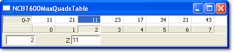
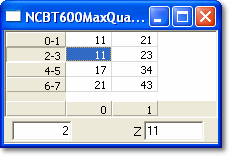

# Arrays

An Array parameter is a one-dimensional, ordered group of values. The ECU selects an index that in turn selects a value. To open an Array window, select **Desktop** > **Window** > **Array** (Alt+Shift+Y).

An Array window in one row

The same Array parameter displayed in three rows

## Features

- An Array Edit window can contain only one Array parameter.
- When a value is changed and accepted, its colour changes to the Greater than / Less than colour (default red/blue) as appropriate. These colours are set in the Display tab of the Window Properties dialog box.
- The window is a grid of cells with the following rows, from top to bottom:
    - One or more rows of output values. The number of rows and columns is set in the Array tab of the Parameter Properties dialog box. This is only for convenience of display, as the Array is one-dimensional; the indices wrap from one row to the next.
    - An axis row, with an index number in each column.
- Values can be displayed as **Engineering**, **Raw Hexadecimal** or **Raw Decimal**, selected from the Window System Menu.
- A String parameter can be associated with an Array. The value of the string is shown in the String Bar, below the last row of output values, when **Show String Bar** is selected in the Window System Menu.
- The Edit Bar has an edit box for the index and an edit box for the output value of the selected cell. Enter a number in the first box to select an index; the second box shows the value at that index, which can be edited. The Edit Bar is shown at the bottom of the window when **Show Edit Bar** is selected in the Window System Menu.
- The window title can show the Name of the parameter, the Description or both. This is set in the Parameters tab of the Window Properties dialog box.
- Controls for the appearance of the window are on the Display tab of the Window Properties dialog box.

**See also:** [Changing Parameter Values](changing-parameter-values/index.md); [Creating Windows](../using-system-monitor/windows/creating-windows/index.md); [Editable Parameters](../using-system-monitor/parameters/editable-parameters.md); [Parameter Properties – Array tab](../using-system-monitor/parameters/parameter-properties/array-tab.md)
