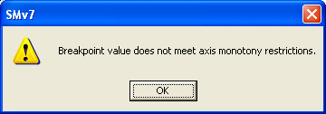

# Breakpoint Monotony

All Breakpoint values must either increase or decrease along the axis. This restriction is called Monotony. The direction of monotony is set in the ASAP file and can be viewed in the General tab of the Axis Properties dialog box.

This means that a Breakpoint value cannot be higher than the next highest value or lower than the next lowest. If you enter a value that breaks this rule, the message "Breakpoint value does not meet axis monotony restrictions." is shown and the value is not accepted.

Click **OK** to close the message. The value that was entered is replaced by the original value. Only values that lie between the neighbouring Breakpoint values can be accepted.

**See also:** [Axis Properties – General](../../using-system-monitor/parameters/parameter-properties/axis-properties/axis-properties-general.md); [Changing Breakpoint Values](changing-breakpoint-values-by-mouse.md)
