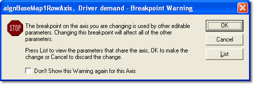
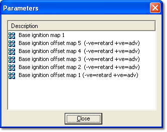

# Breakpoint Warning

Changing Breakpoint values affects the axis wherever it is used, not just in the current window. If the axis is used by other editable parameters, System Monitor displays a Breakpoint Warning.

- **OK** - Makes the change.
- **Cancel** - Discards the change.
- **List** - Opens a list of all the parameters that use the axis, to help you judge the effect of the change.
- **Don't Show this Warning again for this Axis** - Select this to stop the warning being shown for this axis.

**See also:** [Changing Breakpoint Values](changing-breakpoint-values-by-mouse.md); [Breakpoint Monotony](breakpoint-monotony.md)
