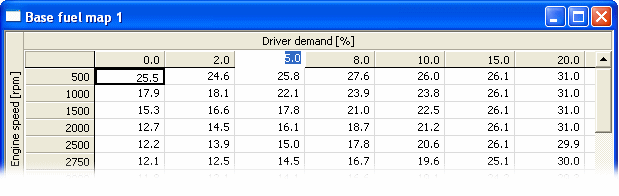

# Changing Breakpoint Values

## Mouse operation

To select an X-axis Breakpoint, click the column header. To select a Y-axis Breakpoint, click the row header. When a cell is selected, it changes to [Edit Mode](parameter-edit-mode.md). Enter a new value to overwrite the existing value.

!!! note
    If **Orientation** is selected in the Window System Menu, the axes are rotated.

Alternatively, click the appropriate Breakpoint edit box in the Edit Bar and overwrite the value.

## Keyboard operation

1. Use the cursor keys to select a cell that uses the Breakpoint you want to change.
2. Use the TAB key to cycle through the edit boxes in the Edit Bar. The TAB key then returns to the value in the map table.
3. Select the Breakpoint that you want to change and enter a new value to overwrite the existing value.

**See also:** [Breakpoint Warning](breakpoint-warning.md); [Breakpoint Monotony](breakpoint-monotony.md)
