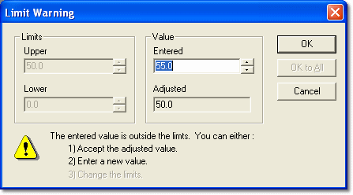

# Value Limit Warning

Each parameter has an upper and a lower limit that are set in the ASAP file. The limits can be viewed in the Conversion tab of the [Parameter Properties](../../using-system-monitor/parameters/parameter-properties/conversion-tab.md) dialog box.

If a value is changed so that it is outside the limits, the Limit Warning dialog box opens. It offers three choices: accept the adjusted value, enter a new value, or change the limits.

The **Limits** panel shows the **Upper** and **Lower** limits. If the Parameter Properties can be edited, these boxes are editable and the limits can be changed.

The **Value** panel contains:

- **Entered** - The out-of-range number that was entered. If you edit this box to a number that is within range, the new number is accepted when you click **OK**.
- **Adjusted** - A suggested number: the limit nearest to the out-of-range number that was entered. If you click **OK** without editing the **Entered** box, the adjusted number is accepted.

| Button | Action |
|---|---|
| **OK** | Replaces the selected value with the value in the **Entered** box, if it is within limits; otherwise uses the value in the **Adjusted** box. If multiple values are being changed, steps through the values one at a time. |
| **OK to All** | Available for multiple values only. As **OK**, but applies the same change to all the values. |
| **Cancel** | The change is ignored and the original value is kept. |

**See also:** [Changing Parameter Values](index.md); [Parameter Properties – Conversion tab](../../using-system-monitor/parameters/parameter-properties/conversion-tab.md)
