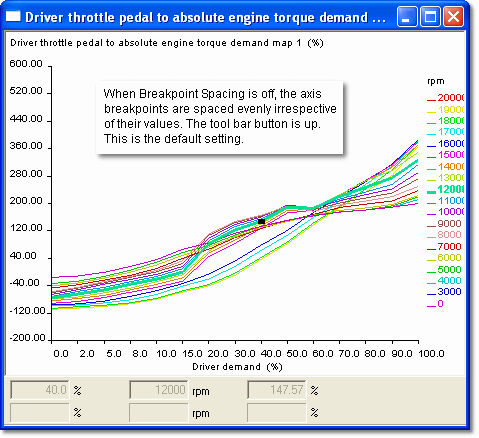
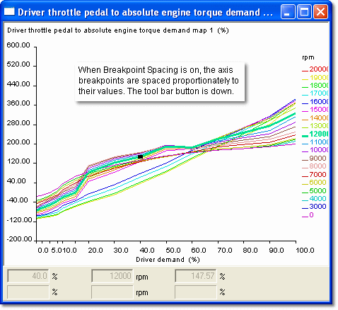

# Breakpoint Spacing

All graphical views can be shown with the Breakpoints either evenly spaced (**Constant spacing**) or spaced in proportion to their values (**Proportional spacing**). The **Breakpoint spacing** button on the Map Bar toggles between the two.

Constant breakpoint spacing

Proportional breakpoint spacing

**See also:** [Graphical Maps](index.md); [Map Bar](../../using-system-monitor/tool-and-information-bars/map-bar.md)
