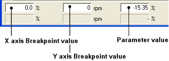

# Changing Values in a Graphical view

Parameter values can be changed in any graphical view except the Difference View. Values can only be changed in the Active Applications.

In a 1 axis graphical view, you can select all the values of the selected parameter with the **Select all** button on the Map Bar. In all other graphical views you can only select one value at a time. To change multiple values, switch to a grid view (see [Changing Parameter Values](../changing-parameter-values/index.md)).

## Change a value in a graphical view

1. Select a value:
    - On a three-dimensional display, click an intersection on the surface or use the cursor keys to move around the surface.
    - On a two-dimensional display, click the trace where it is intersected by a Breakpoint, or use the left/right cursor keys to move along the trace and the up/down keys to select a trace.
    - For either display, switch to a grid view, select a value with the mouse or keyboard, then return to the graphical view. Use Alt+G to toggle between the grid and graphical views.

    The selected value is marked by a black spot. The Breakpoints and value of the selected point are shown in the Edit Bar.

2. Change the value:
    - **By mouse** - drag the value up or down. If the view is zoomed in, the display continually redraws to keep the value at the centre (the landscape appears to move under the point).
    - **By keyboard** - use the TAB key to cycle through the boxes in the Edit Bar, enter a new value and press ENTER to accept it and redraw the map.

!!! note
    The Maths Bar can be used to change values selected in a graphical view.

**See also:** [Graphical Maps](index.md); [Zooming a Graphical view](zooming-a-graphical-view.md)
