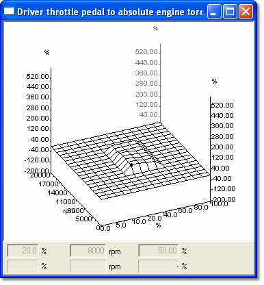

# Difference View

Select **Difference** in the Window System Menu, or step through the options with the **View mode** button on the Map Bar. Values cannot be changed in the Difference View.

Difference View for a 2-axis Map

The difference value is the amount by which the current value in the Edit Buffer differs from the value in the Data Version. In the Difference View the difference value is plotted against the Index Value(s). All unchanged values are zero.

- **1-axis Maps** - The display is a two-dimensional graph of difference value plotted against Index Value. Only one parameter is shown; the name of the currently selected parameter is shown at the top of the window. The largest difference value (positive or negative) sets the axis upper and lower values.
- **2-axis Maps** - The display is a three-dimensional graph of difference value plotted against two Index Values (X and Y). The upper axis value is the same as in the [Graphical View – 2 axis](graphical-view-2-axis.md) and the lower value is the same magnitude but negative. The 2-axis Difference View can be [rotated](rotating-a-graphical-view.md).

For both views, the axis subdivisions and labels are generated automatically, the [Breakpoint Spacing](breakpoint-spacing.md) can be constant or proportional, and the view can be [zoomed](zooming-a-graphical-view.md).

**See also:** [Breakpoint Spacing](breakpoint-spacing.md); [Developing Data Versions](../../project-management/developing-data-versions/index.md); [Graphical Maps](index.md)
