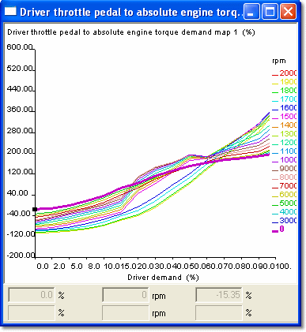

# End View

Select **End** in the Window System Menu of a 2-axis Map, or step through the options with the **View mode** button on the Map Bar.

The display is a two-dimensional graph of parameter value plotted against the X Index Value, with a trace for each Y Index Value. The trace of the currently selected Y Index Value is shown bold in the colour selected for Active Map in the Display tab of the Window Properties dialog box. The other traces are shown in the colour selected for Inactive Map.

- The axis upper and lower values are set in the relevant Conversion dialog boxes. The axis subdivisions and labels are generated automatically. **AutoZoom** in the Window System Menu scales end views and slices to fit the window.
- The [Breakpoint Spacing](breakpoint-spacing.md) can be constant or proportional.
- Values can be edited in this view.

**See also:** [Axis Properties – Conversion](../../using-system-monitor/parameters/parameter-properties/axis-properties/axis-properties-conversion.md); [Breakpoint Spacing](breakpoint-spacing.md); [Parameter Properties – Conversion tab](../../using-system-monitor/parameters/parameter-properties/conversion-tab.md)
