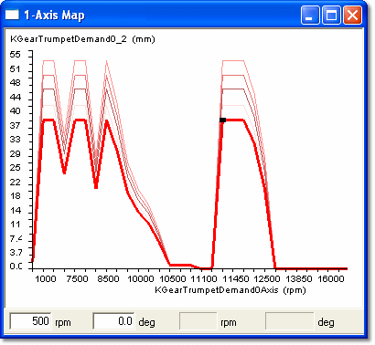

# Graphical View – 1 axis

Select **Graphical** in the Window System Menu, or step through the options with the **View mode** button on the Map Bar.

Graphical view of a window containing six 1 axis parameters

For a 1 axis Map, the graphical display is a two-dimensional graph of parameter value plotted against Index Value, with a trace for each parameter in the window. The name of the currently selected parameter is shown at the top of the window. The trace of the currently selected parameter is shown bold in the colour selected for Active Map in the Display tab of the Window Properties dialog box. The remaining traces are shown in the colour selected for Inactive Map.

The axis upper and lower values are set in the relevant Conversion dialog boxes (see Parameter Properties – Conversion tab and Axis Properties – Conversion). The axis subdivisions and labels are generated automatically; **AutoZoom** in the Window System Menu scales the vertical axis so the traces fit the window. The [Breakpoint Spacing](breakpoint-spacing.md) can be constant or proportional.

**See also:** [Axis Properties – Conversion](../../using-system-monitor/parameters/parameter-properties/axis-properties/axis-properties-conversion.md); [Parameter Properties – Conversion tab](../../using-system-monitor/parameters/parameter-properties/conversion-tab.md); [Window Properties – Display tab](../../using-system-monitor/windows/using-windows/window-properties-display-tab.md)
