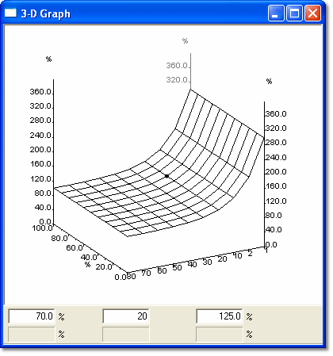

# Graphical View – 2 axis

Select **Graphical** in the Window System Menu, or step through the options with the **View mode** button on the Map Bar.

For a 2-axis Map, the display is a three-dimensional graph of parameter value plotted against two Index Values (X and Y).

- The axis upper and lower values are set in the relevant Conversion dialog boxes (see Parameter Properties – Conversion tab and Axis Properties – Conversion). The axis subdivisions and labels are generated automatically.
- The [Breakpoint Spacing](breakpoint-spacing.md) can be constant or proportional.
- Hidden lines are removed. To see a value below the surface, select [End View](end-view.md) or [Slice View](slice-view.md).
- The view can be [rotated](rotating-a-graphical-view.md) and [zoomed](zooming-a-graphical-view.md), and values can be [changed](changing-values-in-a-graphical-view.md).

**See also:** [Parameter Properties – Conversion tab](../../using-system-monitor/parameters/parameter-properties/conversion-tab.md); [Axis Properties – Conversion](../../using-system-monitor/parameters/parameter-properties/axis-properties/axis-properties-conversion.md)
