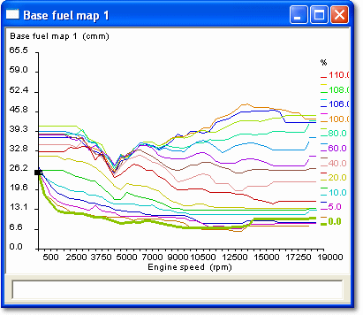
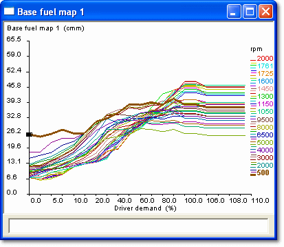

# Slice View

The Slice View is only available for a 2-axis Map window in a graphical view. It is selected with the **Slice X** and **Slice Y** buttons on the Map Bar.

Slice View on the X axis

The **Slice X** display is a two-dimensional graph of parameter value plotted against the X Index Value, for the Y Index Breakpoint that includes the selected value. The trace is shown bold in the colour selected for Active Map in the Display tab of the Window Properties dialog box. Traces for higher Y Index values (behind) are shown in the colour selected for Inactive Map.

Slice View on the Y axis

The **Slice Y** display is a two-dimensional graph of parameter value plotted against the Y Index Value, for the X Index Breakpoint that includes the selected value. The trace is shown bold in the Active Map colour; traces for higher X Index values (behind) are shown in the Inactive Map colour.

For both slices:

- The axis upper and lower values are set in the relevant Conversion dialog boxes. The axis subdivisions and labels are generated automatically; **AutoZoom** in the Window System Menu scales slices to fit the window.
- The [Breakpoint Spacing](breakpoint-spacing.md) can be constant or proportional.
- The view can be zoomed and the values can be edited.

**See also:** [2 axis Map](../2-axis-map-window.md); [Axis Properties – Conversion](../../using-system-monitor/parameters/parameter-properties/axis-properties/axis-properties-conversion.md); [End View](end-view.md); [Graphical Maps](index.md); [Parameter Properties – Conversion tab](../../using-system-monitor/parameters/parameter-properties/conversion-tab.md)
