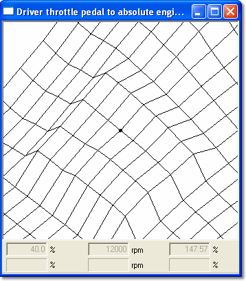

# Zooming a Graphical view

All graphical views can be zoomed with buttons on the Map Bar:

- **Zoom in** - Increases the size of the view by 50%.
- **Zoom out** - Cancels each Zoom in step in turn.

When the view is zoomed in, it is centred on the currently selected value. As soon as a value is selected or moved, the display is redrawn to place the value at the centre (the landscape appears to move under the point).

**To select a value:**

- On a three-dimensional display, click an intersection on the surface or use the cursor keys to move around the surface.
- On a two-dimensional display, click the trace where it is intersected by a Breakpoint, or use the left/right cursor keys to move along the trace and the up/down keys to select a trace.
- For either display, switch to a grid view, select a value with the mouse or keyboard, then return to the graphical view.

!!! tip
    Use Alt+G to toggle between the grid and graphical views.

The zoom setting is kept for a window even if its view mode is changed.

For two-dimensional displays, **AutoZoom** in the Window System Menu scales the vertical axis so that the traces fit the plot area.

**See also:** [Graphical Maps](index.md)
