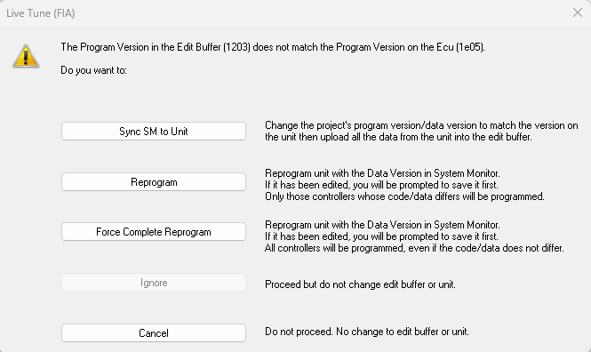

# Live Tune

When Live Tune is on, the Edit Buffer and the ECU RAM are kept synchronised: any change in the Edit Buffer is downloaded to the ECU as soon as it is made.

To switch Live Tune on and off, select **ECU** > **Live Updates** (F4). The status of Live Tune is shown on the [Comms Bar](../using-system-monitor/tool-and-information-bars/comms-bar.md) (**Updates ON** / **Updates OFF**).

!!! note
    The data changes only affect the ECU RAM. To apply the changes to the vehicle systems, the ECU must be operating from RAM. The memory used by the ECU is selected with the [Run from ROM](../ecu-control/ecu-memory/run-from-rom.md) and [Run from RAM](../ecu-control/ecu-memory/run-from-ram.md) commands on the ECU menu.

**Live Updates** is not available when:

- **Permit live updates** is set to false for the Customer Base (see [Customer Base Advanced Settings](../project-management/customer-bases/customer-base-advanced-settings.md)).
- **ECU read only mode** is set to **Y** in [Advanced Settings](../using-system-monitor/settings.md).
- [Live Auto Tune](live-auto-tune.md) is on (Live Updates stays on and cannot be switched off).
- The licence is a GT Customer or GT Track Support licence.

## Starting Live Updates

When Live Updates is switched on, System Monitor checks each Active Application:

- If you have edited parameters that cannot be live tuned, a message asks you to reprogram the unit or restore the values of those parameters first.
- If the Program Version or Data Version in the Edit Buffer does not match the one in the ECU, the following message opens:

| Button | Action |
|---|---|
| **Sync SM to Unit** | Changes the project's Program Version / Data Version to match the version on the unit, then uploads all the data from the unit into the Edit Buffer. If a file cannot be found, a new file is created using the filename and modification information taken from the unit. |
| **Reprogram** | Reprograms the unit with the Data Version in System Monitor (you are prompted to save it first if it has been edited). Only the controllers whose code or data differs are programmed. Any changes in the Edit Buffer are then downloaded. |
| **Force Complete Reprogram** | As **Reprogram**, but all controllers are programmed even if their code or data does not differ. |
| **Ignore** | Not available when starting Live Updates. |
| **Cancel** | Closes the message. Live Updates is not switched on and no change is made to the Edit Buffer or the unit. |

- If the versions match but the data in the unit differs from the Edit Buffer (for example, the unit contains live tunes made elsewhere), System Monitor downloads the changes automatically when it can tell that the unit has not been changed since it was last in step. Otherwise a message offers **Upload Data** (upload all the data from the unit into the Edit Buffer), **Download Data Changes** (download the Edit Buffer to the unit; live tunes in the unit may be lost) or **Cancel**. **Ignore** (enable Live Updates without changing either) is offered only if the data in the unit could not be compared.

**See also:** [Customer Base Advanced Settings](../project-management/customer-bases/customer-base-advanced-settings.md); [ECU Control](../ecu-control/index.md); [ECU Memory](../ecu-control/ecu-memory/index.md); [Data Changes in the ECU](../ecu-control/data-changes-in-the-ecu/index.md); [Developing Data Versions](../project-management/developing-data-versions/index.md); [Run from RAM](../ecu-control/ecu-memory/run-from-ram.md); [Run from ROM](../ecu-control/ecu-memory/run-from-rom.md); [Tuning](index.md)
