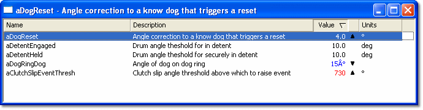

# Scalar

The value of a Scalar parameter is a single constant.

A Scalar Edit window can contain any number of Scalar parameters. To open one, select **Desktop** > **Window** > **Scalar** (Alt+Shift+S).

Each Scalar parameter is displayed as a row with the following columns:

| Column | Description |
|---|---|
| **Name** / **Description** | The Name, the Description or both may be displayed for each parameter. This is set in the Parameters tab of the Window Properties dialog box. |
| **Value** | The value of the parameter. The display format is set in the Parameters tab of the Window Properties dialog box or from the Window System Menu: **Engineering**, **Raw Hexadecimal**, **Raw Binary** or **Raw Decimal**. |
| (unlabelled) | A trend arrow shows the direction of the last change: increased  or decreased . |
| **Units** | The engineering units of the value. Only shown when the display format is **Engineering**. |
| **Address** | The location of the parameter value in ECU memory. Only shown when a raw format (**Raw Hexadecimal**, **Raw Binary** or **Raw Decimal**) is selected. Parameters locked with enhanced RDA show `-`. |

The value can be changed (see [Changing Parameter Values](changing-parameter-values/index.md)). When a new value is accepted, its colour changes to the Greater than / Less than colour (default red and blue) as appropriate. The colours are set in the [Display tab](../using-system-monitor/windows/using-windows/window-properties-display-tab.md) of the Window Properties dialog box.

The column widths can be changed and the parameters can be sorted. See [Columns in Tabular Windows](../using-system-monitor/windows/using-windows/columns-in-tabular-windows.md).

The Window System Menu also offers **Normal Font** / **Large Font** and **Show Column Headings**.

!!! note
    Scalar parameters can also be edited in a Grid window.

**See also:** [Creating Windows](../using-system-monitor/windows/creating-windows/index.md); [Editable Parameters](../using-system-monitor/parameters/editable-parameters.md); [Changing Parameter Values](changing-parameter-values/index.md); [Windows](../using-system-monitor/windows/index.md)
