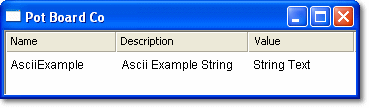

# Strings

The output of a String parameter is a text string; it does not have a numerical value. A String Edit window can contain any number of String parameters. To open one, select **Desktop** > **Window** > **String** (Alt+Shift+R).

Each String parameter is displayed as a row with the following columns:

| Column | Description |
|---|---|
| **Name** / **Description** | The Name, the Description or both may be displayed for each parameter. This is set in the Parameters tab of the Window Properties dialog box. |
| **Value** | The value of the parameter, which can be edited. The number of characters entered cannot exceed the length of the string, which is defined in the ASAP file. The length can be viewed, but not edited, in the String tab of the Parameter Properties dialog box. |

- The column widths can be changed and the parameters can be sorted. See [Columns in Tabular Windows](../using-system-monitor/windows/using-windows/columns-in-tabular-windows.md).
- Controls for the appearance of the window are on the Display tab of the Window Properties dialog box. The Window System Menu also offers **Normal Font** and **Large Font**.
- A String parameter can be associated with a 1 axis map, a 2 axis map or an Array. Its value is then shown in the String Bar of that window.

**See also:** [Changing Parameter Values](changing-parameter-values/index.md); [Columns in Tabular Windows](../using-system-monitor/windows/using-windows/columns-in-tabular-windows.md); [Editable Parameters](../using-system-monitor/parameters/editable-parameters.md); [Parameter Properties – String tab](../using-system-monitor/parameters/parameter-properties/string-tab.md)
