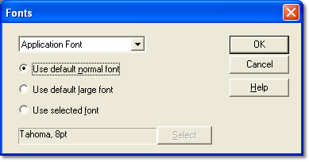

# Fonts

You can change the style and size of the fonts on the Desktop in the Fonts dialog box. To open it, select **Desktop** > **Fonts...**.

Select the area that you want to configure from the drop-down list:

- **Application Font** - The font used for application areas such as Parameter Explorer, the ECU Bar and the parameter selection dialog boxes.
- **Window Font** - The font used for Windows. This can be overridden for each Window on the [Window Properties – Display tab](../windows/using-windows/window-properties-display-tab.md).
- **Page Bar Font** - The font used for the Page Bar.

For each area, choose one of:

- **Use default normal font** - Text is displayed in MS Sans Serif 8pt. This is the default.
- **Use default large font** - Text is displayed using a font 4 times larger than the default font.
- **Use selected font** - Text is displayed using the font shown in the box. Click **Select** to choose the font.

**See also:** [Desktop Menu](../menus/desktop-menu.md); [Window Properties – Display tab](../windows/using-windows/window-properties-display-tab.md)
