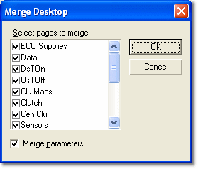

# Merging Desktops

Pages from other Desktops can be added to the current Desktop by Merging.

To merge Desktops:

1. Select **File** > **Open**. From the File Open list, double-click **Desktop**.
2. Select the `.dtp` Desktop file that you want to copy Pages from and click **Merge**. Do not open the file.

    The Merge Desktop dialog box opens, listing the names of all the Pages in the file.

    

3. Under **Select pages to merge**, select the Pages that you want to merge.
4. Select **Merge parameters** if you also want to merge the Parameters from the selected Desktop into the current Desktop.
5. Click **OK**.

The selected Pages are added after the Pages already in the Desktop.

!!! note
    If a Page merged into the current Desktop has the same name as a Page already in the Desktop, its name is not changed. Rename the Pages if necessary (see [Page Properties](../pages/page-properties.md)).

**See also:** [Desktop Files](desktop-files.md); [Pages](../pages/index.md)
