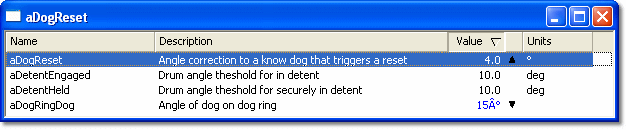
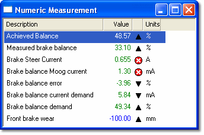

# Using System Monitor

System Monitor is a tool for configuring ECUs. Any aspect of the ECU that can be changed is available as an Editable Parameter. Parameters are edited in System Monitor Edit Windows. The type of Window available and the method of editing depend on the type of Editable Parameter.

*Editable Parameters (Scalars) in a System Monitor Window*

To help you change the Editable Parameters, the Measurement Parameters available to the ECU can be displayed. Measurement Parameters are either generated from the internal operation of the ECU or come from external sensors. They are viewed in Measurement Windows. Various types of Window are available to give different types of display.

*Measurement Parameters in a System Monitor Window*

The Windows containing Editable Parameters (Edit Windows) and the Windows containing Measurement Parameters (Measurement Windows) are laid out on Pages of a Desktop in the [Main Window](main-window.md).

System Monitor also includes facilities to control the way that an ECU collects data.

This section describes the [Main Window](main-window.md), [Menus](menus/index.md), [Tool and Information Bars](tool-and-information-bars/index.md), the [Desktop](desktop/index.md), [Pages](pages/index.md), [Windows](windows/index.md), [Printing](printing/printer-support.md), [Keyboard Operation](keyboard-operation.md) and [Settings](settings.md).

**See also:** [Data Acquisition](../data-acquisition/index.md); [Data Display](../data-display/index.md); [Editable Parameters](parameters/editable-parameters.md); [History Report](../history-report/index.md); [Measurement Parameters](parameters/measurement-parameters.md); [Project Management](../project-management/index.md)
