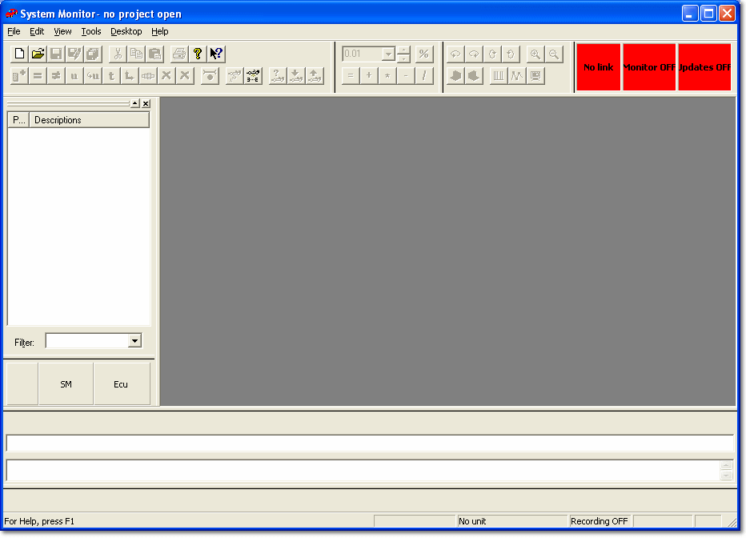
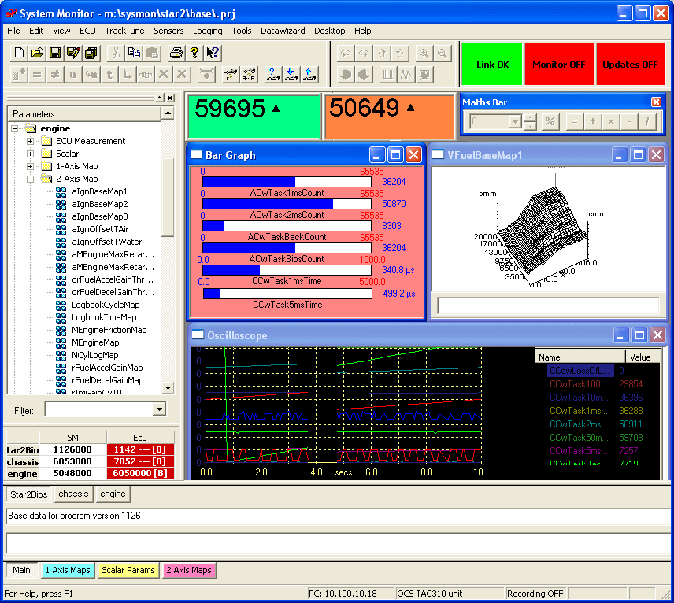

# Main Window

When System Monitor is started, no Project is loaded (unless the Advanced Setting **Open most recently used project** is **Y**). Your screen may look different because many of the features can be moved or hidden.

## Main Window with no Project open

When a Project is loaded, a Desktop containing one or more Pages is added, and the full set of [Menus](menus/index.md) becomes available.

## Main Window with a Project loaded

The Main Window contains:

- the [Menu Bar](menus/index.md)
- the [Tool and Information Bars](tool-and-information-bars/index.md), including the Page Bar
- the [Parameter Explorer](parameters/parameter-explorer.md)
- the [Desktop](desktop/index.md), showing the current [Page](pages/index.md) and its [Windows](windows/index.md)
- the [Status Bar](tool-and-information-bars/status-bar.md)

**See also:** [Desktop](desktop/index.md); [Getting Started](../getting-started/index.md); [Settings](settings.md)
