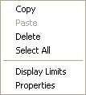

# Bar Graph Context Menu

The Bar Graph Context menu allows you to work with Parameters in a Bar Graph window.

Open the Context menu while the mouse pointer is over a bar. The commands operate on the selected parameter(s).

| Command | Description |
|---|---|
| **Copy** | Copies the selected [Parameter(s)](../../parameters/index.md) to the clipboard. |
| **Paste** | Copies the contents of the clipboard to the selected location. Only available when the clipboard contains information that can be transferred to the selected Window type. |
| **Delete** (DELETE) | Deletes the selected Parameter(s) from the Window. |
| **Select All** | Selects all the parameters in the Window. |
| **Display Limits** | Opens the [Bar Graph – Display Limits](../../../data-display/bar-graph-display/bar-graph-display-limits.md) dialog box for the selected Parameter, or for the Parameter that was selected last if more than one is selected. |
| **Properties** | Opens the [Parameter Properties](../../parameters/parameter-properties/index.md) dialog box for the selected Parameter, or for the Parameter that was selected last if more than one is selected. |

**See also:** [Bar Graph](../../../data-display/bar-graph-display/bar-graph.md); [Context Menus](index.md)
