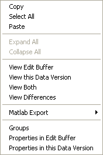

# Data Wizard Context Menu

The Context menu in a [Report View](../../../project-management/data-wizard/data-wizard-report-view.md) or a [Candidate Data Version Window](../../../project-management/data-wizard/data-wizard-candidate-version.md) allows you to work with Parameters in [Data Wizard](../../../project-management/data-wizard/index.md).

## Parameter context menu

Right-click a Parameter to open this menu.

| Command | Description |
|---|---|
| **Copy** (CTRL+C) | Copies the selected Parameter to the clipboard. |
| **Select All** (CTRL+A) | Selects all the parameters in the Window. |
| **Paste** (CTRL+V) | Copies the contents of the clipboard to the selected location. Only available when the clipboard contains information that can be transferred to the selected Window type. |
| **Expand All** / **Collapse All** | Expands or collapses all the folders contained in the selected folder. |
| **View Edit Buffer** | Shows the value of the selected Parameter currently stored in the Edit Buffer. |
| **View this Data Version** | Shows the value of the selected Parameter in this Data Version. |
| **View Both** | Shows the value of the selected Parameter in both the Edit Buffer and this Data Version. |
| **View Differences** | Shows the differences between the Edit Buffer and this Data Version for the selected Parameter in a printable format. See [Data Wizard – View Parameter](../../../project-management/data-wizard/data-wizard-view-parameter.md). |
| **Matlab Export** | Exports Parameter definitions and data in a format suitable for MATLAB. Choose **Selected Parameters Only** or **Selected Application Parameters Only**, then **Memory** (the Edit Buffer) or **Data Version**, then **Definition and Data...** (property settings as well as values) or **Data Only...** (values only). **Export without versioning** offers the same choices. |
| **Groups** | Displays the Parameters in Groups. |
| **Properties in Edit Buffer** | Opens the Parameter Properties dialog box showing the properties stored in the Edit Buffer. |
| **Properties in this Data Version** | Opens the Parameter Properties dialog box showing the properties in this Data Version. |

## Group context menu

Right-click a Group to open a shorter menu containing **Copy**, **Select All**, **Paste**, **Expand All**, **Collapse All**, **Matlab Export** and **Groups**.

## Compare/Merge Tool

In the [Compare/Merge Tool](../../../project-management/data-wizard/compare-merge-tool.md) the Parameter context menu contains:

- **Expand Selected**, **Expand All** and **Collapse All**
- **Compare View**, **View Edit Buffer**, **View Dtv1** and **View Dtv2**
- **Matlab Export**, with **Memory**, **DTV1** and **DTV2** choices
- **Groups**, **Properties in Edit Buffer** and **Properties in Dtv1**

The Group context menu contains **Expand Selected**, **Expand All**, **Collapse All**, **Matlab Export** and **Groups**.

**See also:** [Data Wizard – Window Menu](../../../project-management/data-wizard/data-wizard-window-menu.md); [Export to MATLAB](../../../project-management/developing-data-versions/export-to-matlab.md)
