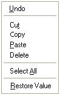

# Edit Context Menu

The Edit context menu allows you to edit text or numbers in a [Parameter Filter](../../parameters/selecting-parameters/parameter-filter.md), in the Value of an [Editable Parameter](../../parameters/editable-parameters.md) or in any editable text box.

Open the Context menu when the mouse pointer is over an item of editable text.

!!! note
    You can only open the Edit Context Menu for an Editable Parameter value when it is in [Edit Mode](../../../tuning/changing-parameter-values/parameter-edit-mode.md). To turn Edit Mode on, press ENTER.

For an Editable Parameter value in Edit Mode the menu contains:

| Command | Description |
|---|---|
| **Undo** | Undoes the previous text editing action. Unavailable if there is nothing to undo. |
| **Cut** | Copies the selected text to the clipboard and deletes it. Only available when text is selected. |
| **Copy** | Copies the selected text to the clipboard. Only available when text is selected. |
| **Paste** | Copies the text in the clipboard to the cursor position. Only available when the clipboard contains text. |
| **Delete** | Deletes the selected text. Only available when text is selected. |
| **Copy String** | Copies the selected text to the clipboard as a string. Only available when text is selected. |
| **Select All** | Selects all the text in the Value cell. |
| **Restore Value** | Discards any changes to the value or breakpoint and replaces it with the value from the current Data Version. Also on the [Edit Menu](../edit-menu.md) (F2). |

In other text boxes, such as the Parameter Filter, the standard Windows text editing commands (**Undo**, **Cut**, **Copy**, **Paste**, **Delete** and **Select All**) are available.

**See also:** [Context Menus](index.md); [Windows Context Menu](windows-context-menu.md)
