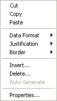

# Grid Cell Context Menu

The Grid Cell Context menu allows you to work with single or multiple cells in a Grid Window. The menu can only be opened when the Grid Window is in [Edit Mode](../../../data-display/grid-display/grid-window-edit-mode.md).

| Command | Description |
|---|---|
| **Cut** | Copies the content of the selected cell(s) to the clipboard and empties the cell(s). |
| **Copy** | Copies the content of the selected cell(s) to the clipboard. |
| **Paste** | Copies the content of the clipboard to the selected cell. If multiple cells are in the clipboard, only the first (top, left) cell is copied. |
| **Data Format** | Sub-menu to select what the selected cell shows: **Name**, **Units**, **Raw Value**, **Engineering**, **Binary**, **Decimal**, **Description**, **Trend**, **Error**, **Status**, **Slider** or **Button**. See [Cell Properties – Contents](../../../data-display/grid-display/cell-properties-contents.md). |
| **Justification** | Sub-menu: **Left Justified**, **Right Justified** (default) or **Centre Justified** aligns the text and numbers in the selected cell. |
| **Border** | Sub-menu: **Top Border**, **Bottom Border**, **Left Border** or **Right Border** places a border line on that side of the selected cell. See [Cell Properties – Formatting](../../../data-display/grid-display/cell-properties-formatting.md). Gridlines are toggled on and off from the [System Menu](../../../data-display/grid-display/system-menu-grid.md). |
| **Action Button** | Sub-menu: **Single Message...** or **Run Script...** sets the action performed by a Button cell. |
| **Insert...** | Opens the [Insert Columns/Rows](../../../data-display/grid-display/insert-columns-rows.md) dialog box. |
| **Delete...** | Opens the [Delete Columns/Rows](../../../data-display/grid-display/delete-columns-rows.md) dialog box. |
| **Auto Generate** | Automatically fills the Grid from the parameters. |
| **Properties...** | Opens the [Cell Properties](../../../data-display/grid-display/cell-properties.md) dialog box for the selected cell, or for the first (top, left) cell if more than one cell is selected. |

**See also:** [Context Menus](index.md); [Grid](../../../data-display/grid-display/grid.md)
