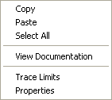

# Oscilloscope Context Menu

The Oscilloscope Context menu allows you to work with Parameters in an Oscilloscope Window.

The commands operate on the parameter(s) selected in the [Parameter Info](../../../data-display/oscilloscope-display/oscilloscope-parameter-info.md) area.

| Command | Description |
|---|---|
| **Copy** | Copies the selected [Parameter(s)](../../parameters/index.md) to the clipboard. |
| **Paste** | Copies the contents of the clipboard to the selected location. Only available when the clipboard contains information that can be transferred to the selected Window type. |
| **Select All** | Selects all the parameters in the Window. |
| **View Documentation** | Opens contextual documentation for the Parameter, including clickable process diagrams for both Measurement and Editable Parameters. |
| **Trace Limits** | Opens the [Oscilloscope – Trace Limits](../../../data-display/oscilloscope-display/oscilloscope-trace-limits.md) dialog box for the selected Parameter, or for the first Parameter in the list if more than one is selected. |
| **Properties** | Opens the [Parameter Properties](../../parameters/parameter-properties/index.md) dialog box for the selected Parameter, or for the first Parameter in the list if more than one is selected. |

**See also:** [Context Menus](index.md); [Oscilloscope](../../../data-display/oscilloscope-display/oscilloscope.md); [System Menu – Oscilloscope](../../../data-display/oscilloscope-display/system-menu-oscilloscope.md)
