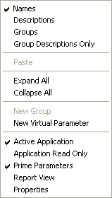
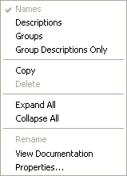

# Parameter Explorer Context Menu

The Context menu in Parameter Explorer allows you to change the appearance of Parameter Explorer and work with Applications, Groups and Parameters.

The commands available depend on the item selected.

| Group context menu | Application context menu |
|---|---|
|  |  |

## Commands on every menu

| Command | Description |
|---|---|
| **Names** (CTRL+ALT+N) | When ticked, the Parameter Name is displayed in Parameter Explorer. |
| **Descriptions** (CTRL+ALT+D) | When ticked, the Parameter Description is displayed in Parameter Explorer. |
| **Groups** (CTRL+ALT+G) | When ticked, the Parameters are arranged in Groups. When not ticked, the Parameters are arranged by type. |
| **Group Descriptions Only** | When ticked, only Group descriptions are displayed for Groups. |
| **Display Unlocked Parameters Only** / **Display Locked Parameters Only** / **Display All Parameters** | Selects which parameters are shown, according to the [Parameter Unlock List](../../parameters/locked-parameters/locked-parameters.md). |
| **Expand All** / **Collapse All** | Expands or collapses all the folders contained in the selected folder. |

## Applications

For an Application the menu also contains:

| Command | Description |
|---|---|
| **Matlab Export** | Exports parameters in MATLAB format: **Selected Parameters Only**, **Selected Application Parameters Only**, **Parameter Selection** or **Application Differences Only**, each with **Definition and Data...** or **Data Only...**. **Export without versioning** offers the same choices. See [Export to MATLAB](../../../project-management/developing-data-versions/export-to-matlab.md). |
| **Export Hex File** | Exports the Application data as a Hex file. |
| **Export FFC File** | Exports an FFC file for the Application. |
| **Active Application** (ALT+A) | Makes the selected Application the [Active Application](../../../project-management/active-application.md). |
| **Application Read Only** | Makes the selected Application Read Only. |
| **Hide Application** | Hides the Application in the [ECU Bar](../../tool-and-information-bars/ecu-bar.md). |
| **Hide Row Data** | Hides the row data for the Application. |
| **Prime Parameters** | When ticked (default), Prime Parameters in the selected Application are displayed. When not ticked, they are hidden. |
| **Report View** | Opens a [Report View](../../../project-management/data-wizard/data-wizard-report-view.md) for the selected Application. |
| **View Documentation** | Opens contextual documentation, including clickable process diagrams. |
| **Properties** | Opens the Application Properties dialog box. |

## Groups and Parameters

For a Group or Parameter the menu also contains:

| Command | Description |
|---|---|
| **Copy** (CTRL+C) | Copies the selected Parameter, or all the Parameters in the Group, to the clipboard. |
| **Matlab Export** | As for Applications. |
| **Rename** | Changes the name of the selected Group. The Group title changes to an editable text box; press ENTER or click outside the text box to accept the new name. Only available for Groups created with **New Group**. |
| **View Documentation** | Opens contextual documentation for the Parameter, including clickable process diagrams for both Measurement and Editable Parameters. Parameters only. |
| **Properties...** | Opens a Properties dialog box appropriate to the selected item, for example Parameter Properties or Group Properties. |

## Virtual Parameters

Under the Virtual Parameter folder the menus also contain:

- **Paste** (CTRL+V) - Copies the contents of the clipboard into the selected Group.
- **Delete** - Deletes the selected Group (with its sub-Groups and Parameters) or Virtual Parameter.
- **New Group** (CTRL+SHIFT+G) - Creates a new Group under the selected Group.
- **New Virtual Parameter** (CTRL+SHIFT+V) - Creates a [Virtual Parameter](../../parameters/virtual-parameters/index.md).
- **Virtual Parameter Import** / **Virtual Parameter Export** - Imports or exports Virtual Parameters.
- **Rename** and **Properties...**

Under CAN and input signal parameters, only the display commands, **Copy** and **Properties...** are available.

**See also:** [Parameter Explorer](../../parameters/parameter-explorer.md); [Names, Descriptions & Groups](../../parameters/names-descriptions-and-groups.md); [View Menu](../view-menu.md)
