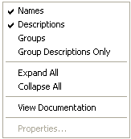

# Select Parameter Context Menu

The Context menu in the Select Parameter(s) dialog boxes for [Multiple](../../parameters/selecting-parameters/selecting-multiple-parameters.md) or [Single](../../parameters/selecting-parameters/selecting-a-single-parameter.md) Parameters allows you to change the appearance of the dialog box.

| Command | Description |
|---|---|
| **Names** | When ticked, shows the Parameter Names. |
| **Descriptions** | When ticked, shows the Parameter Descriptions. |
| **Groups** | When ticked, the Parameters are arranged in Groups. When not ticked, the Parameters are arranged by type. |
| **Group Descriptions Only** | When ticked, only Group descriptions are displayed for Groups. |
| **Display Unlocked Parameters Only** / **Display Locked Parameters Only** / **Display All Parameters** | Selects which parameters are shown, according to the [Parameter Unlock List](../../parameters/locked-parameters/locked-parameters.md). |
| **Expand All** / **Collapse All** | Expands or collapses all the folders contained in the selected folder. |
| **Matlab Export** | Exports the parameters in MATLAB format. See [Export to MATLAB](../../../project-management/developing-data-versions/export-to-matlab.md). |
| **View Documentation** | Opens contextual documentation, including clickable process diagrams for both Measurement and Editable Parameters. |
| **Properties...** | Opens the Properties dialog box for the selected item. |

Commands that do not apply in the dialog box are unavailable.

**See also:** [Context Menus](index.md); [Parameter Filter](../../parameters/selecting-parameters/parameter-filter.md)
