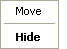

# Tool Bar Context Menu

The Tool Bar Context menu allows you to control the appearance of floating Tool and Information Bars.

Open the Context menu when the mouse pointer is over the title of a floating Tool or Information Bar.

| Command | Description |
|---|---|
| **Move** | Moves the Tool Bar. To use the keyboard, press ALT+- then M, move the Tool Bar with the cursor keys and press ENTER to fix the new position. Once a cursor key has been pressed, you can drag the Tool Bar with the mouse without holding down the mouse button. |
| **Hide** | Closes the Tool Bar. To re-open it, use the commands on the [View Menu](../view-menu.md). |

**See also:** [Tool and Information Bars](../../tool-and-information-bars/index.md)
