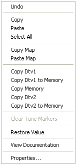

# Windows Context Menu

The Windows Context menu allows you to carry out operations on a [Parameter](../../parameters/index.md) in a [Window](../../windows/index.md).

Open the Context menu when the mouse pointer is in a Window and over a [Measurement Parameter](../../parameters/measurement-parameters.md) or over a value of an [Editable Parameter](../../parameters/editable-parameters.md).

!!! note
    You can only open the Windows Context Menu for an Editable Parameter when it is not in Edit Mode. To turn Edit Mode off, press ESC. In Edit Mode, the [Edit Context Menu](edit-context-menu.md) is shown instead.

The commands available depend on the type of Window:

| Command | Description |
|---|---|
| **Undo** | Undoes the last change to a value. Editable Parameter windows only. |
| **Copy** (CTRL+C) | Copies the selected Measurement Parameter or value of an Editable Parameter to the clipboard. |
| **Paste** (CTRL+V) | Copies the contents of the clipboard to the selected location. Only available when the clipboard contains information that can be transferred to the selected Window type. Measurement Parameters are added to the selected Window. Editable Parameter values overwrite the current values, starting from the selected location. |
| **Select All** (CTRL+A) | Selects all the parameters or values in the Window. |
| **Copy Map** | Copies the Editable Parameter. 1-axis and 2-axis Maps only. |
| **Paste Map** | Copies the map in the clipboard into the selected Window. Map values overwrite the values currently in the Window. Only available when the clipboard contains information that can be transferred to the selected Window type. |
| **Copy Dtv1**, **Copy Dtv1 to Memory**, **Copy Memory**, **Copy Dtv2**, **Copy Dtv2 to Memory** | Copy Parameter values between Data Versions. Only available in the Map Compare window. See [Compare/Merge Tool](../../../project-management/data-wizard/compare-merge-tool.md). |
| **Clear Tune Markers** | Clears the tune markers from the Map. 1-axis and 2-axis Maps only; only available when tune markers exist. |
| **Restore Value** (F2) | Discards any changes to the value or breakpoint and replaces it with the value from the current Data Version. Editable Parameters only. |
| **Maths Bar** | Assigns the parameter to the Maths Bar. Pot Board windows only. |
| **Remove** | Removes the parameter from the Window. Pot Board windows only. |
| **Delete** (DELETE) | Deletes the selected Parameter(s) from the Window. Bar Graph only. |
| **Display Limits** | Bar Graph only. See [Bar Graph Context Menu](bar-graph-context-menu.md). |
| **Trace Limits** | Oscilloscope only. See [Oscilloscope Context Menu](oscilloscope-context-menu.md). |
| **Sample Entire Display** (CTRL+ALT+SHIFT+D) | Resamples all the parameters in the Window. Signal Sampling windows only. |
| **Sample Selected Only** (CTRL+ALT+SHIFT+S) | Resamples the selected parameters. Signal Sampling windows only. |
| **View Documentation** | Opens contextual documentation for the highlighted Parameter, including clickable process diagrams for both Measurement and Editable Parameters. |
| **Properties** | Opens the [Parameter Properties](../../parameters/parameter-properties/index.md) dialog box for the selected parameter. If the Window only supports one Parameter, opens the Parameter Properties dialog box for that Parameter. |

The commands on each type of Window are:

| Window | Commands |
|---|---|
| Numeric | Copy, Paste, Select All, View Documentation, Properties |
| Scalar, Array, String | Undo, Copy, Paste, Select All, Restore Value, View Documentation, Properties |
| 1-axis Map, 2-axis Map | Undo, Copy, Paste, Select All, Copy Map, Paste Map, Copy Dtv1, Copy Dtv1 to Memory, Copy Memory, Copy Dtv2, Copy Dtv2 to Memory, Clear Tune Markers, Restore Value, View Documentation, Properties |
| Pot Board | Undo, Maths Bar, Remove, Copy, Paste, Select All, Restore Value, Properties |
| Bar Graph | See [Bar Graph Context Menu](bar-graph-context-menu.md) |
| Oscilloscope | See [Oscilloscope Context Menu](oscilloscope-context-menu.md) |
| Grid | See [Grid Cell Context Menu](grid-cell-context-menu.md) |
| Dial Gauge | Copy, Paste, Properties |
| Signal Sampling | Copy, Paste, Select All, Sample Entire Display, Sample Selected Only, Properties |

**See also:** [Context Menus](index.md); [Edit Menu](../edit-menu.md); [Window System Menu](../window-system-menu.md)
