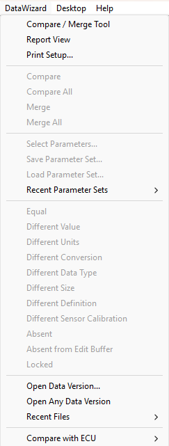

# Data Wizard Menu

The Data Wizard menu is labelled **DataWizard** on the Menu Bar and is available when a Project is open.

| Command | Description |
|---|---|
| **Compare / Merge Tool** | Opens the [Compare/Merge Tool](../../project-management/data-wizard/compare-merge-tool.md) window, which allows Parameters from one or two Candidate Data Versions to be compared and merged with the Merge Buffer. |
| **Report View** | Opens a Data Wizard [Report View](../../project-management/data-wizard/data-wizard-report-view.md), which shows the Editable Parameter values in the Edit Buffer. |
| **Print Setup...** | Opens the [Report Print Options](../printing/data-wizard-print-options.md) dialog box to configure the printout of a Candidate Version or Report View. |
| **Compare** | Re-compares all parameters without changing the list of parameters or the results mask. |
| **Compare All** | Re-compares all parameters, adds all parameters to the window but shows only those that differ. The Selected Parameters and the Parameter Mask are reset to their default values first. |
| **Merge** | Merges the selected parameters into the Edit Buffer. |
| **Merge All** | Merges all compatible parameters into the Edit Buffer, whether or not they are displayed in the open Candidate Data Version window. The Selected Parameters and the Parameter Mask are reset to their default values first. |
| **Select Parameters...** | Opens the Select Parameters dialog box for the selected Report View or Candidate Data Version window. |
| **Save Parameter Set...** | Opens the Save Parameter Set dialog box. Saves the Parameters as a Parameter Set (.pms) file. |
| **Load Parameter Set...** | Opens the Load Parameter Set dialog box. Select a previously saved Parameter Set (.pms) file to load. Parameters already selected are replaced. |
| **Recent Parameter Sets** | Sub-menu listing recently used Parameter Sets. |
| **Equal**, **Different Value**, **Different Units**, **Different Conversion**, **Different Data Type**, **Different Size**, **Different Definition**, **Different Sensor Calibration**, **Absent**, **Absent from Edit Buffer**, **Locked** | Parameter Masking filters, which select the comparison results that are displayed. See [Data Wizard - Parameter Masking](../../project-management/data-wizard/data-wizard-parameter-masking.md). |
| **Open Data Version...** | Opens a Data Wizard [Candidate Data Version](../../project-management/data-wizard/data-wizard-candidate-version.md) window to display a previously created Data Version that you want to compare with the contents of the Edit Buffer. |
| **Open Any Data Version** | Opens a Data Version that is not stored in the active Customer Base. |
| **Recent Files** | Sub-menu listing recently compared Data Versions. Selecting a file opens it in a new Candidate Data Version window. |
| **Compare with ECU** | Sub-menu with one entry for each Application. Uploads the data for the selected Application from the ECU into a Compare View window. The Application's Edit Buffer in System Monitor is not affected. |

!!! note
    The Parameter Masking commands, except **Different Definition**, are also on the [Standard Tool Bar](../tool-and-information-bars/standard-tool-bar.md).

!!! note
    To save data uploaded with **Compare with ECU** as a Data Version, select **Save As Data Version** from the window's System Menu.

**See Also:** [Data Wizard](../../project-management/data-wizard/index.md); [Select Parameters](../parameters/selecting-parameters/selecting-multiple-parameters.md)
