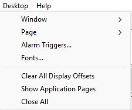

# Desktop Menu

| Command | Description |
|---|---|
| **Window** | Sub-menu to create new Windows (for example a Scalar window) and to manage the Windows on the current Page. See [Creating Empty Windows](../windows/creating-windows/creating-empty-windows.md) and [Using Windows](../windows/using-windows/index.md). |
| **Page** | Sub-menu to create, move, lock, print and close [Pages](../pages/index.md) and to access their properties. |
| **Alarm Triggers...** | Sets up [Alarms](../../data-display/other-displays/alarms/index.md). An alarm consists of a Trigger and a set of Actions. The Actions are carried out as soon as the Trigger criterion becomes TRUE. |
| **Fonts...** | Opens the [Fonts](../desktop/fonts.md) dialog box to configure the fonts used on the Desktop. |
| **Clear All Display Offsets** | After confirmation, removes the display offset from every Measurement Parameter in the Project, whether or not it is shown on the Desktop. |
| **Show Application Pages** | When ticked, the Desktop associated with each Program Version is opened and its Pages are placed at the head of the Page Bar. See [Desktop Files](../desktop/desktop-files.md). |
| **Close All** | After confirmation, closes all Windows and all Pages. The Project remains open. |

With no Project open, the Desktop menu contains only **Close All**, which is unavailable.

!!! note
    The Desktop menu is unavailable with a Formula E licence.

**See also:** [Alarms](../../data-display/other-displays/alarms/index.md); [Creating Empty Windows](../windows/creating-windows/creating-empty-windows.md); [Pages](../pages/index.md)
