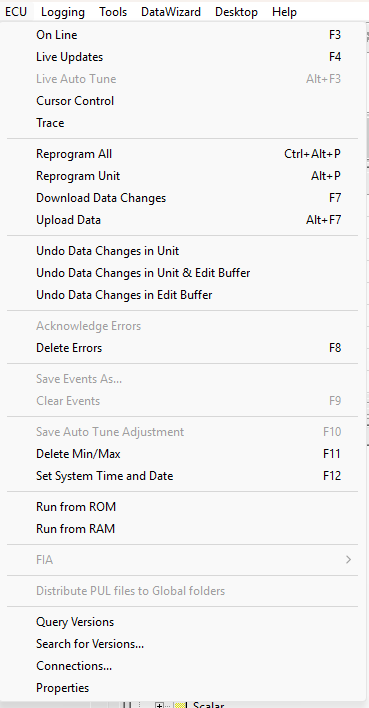

# ECU Menu

The ECU menu is available when a Project is open.

| Command | Description |
|---|---|
| **On Line** (F3) | Puts the ECU On-Line or Off-Line. See [ECU On-Line](../../ecu-control/ecu-on-line.md). |
| **Live Updates** (F4) | Sends changes to Editable Parameters to the ECU as they are made. See [Live Tune](../../tuning/live-tune.md). |
| **Live Auto Tune** (ALT+F3) | See [Live Auto Tune](../../tuning/live-auto-tune.md). |
| **Cursor Control** | Positions the map edit cursor on the active cell. See [Cursor Control and Trace](../../ecu-control/cursor-control-and-trace.md). |
| **Trace** | Shows a trace of the map cells that have been visited. See [Cursor Control and Trace](../../ecu-control/cursor-control-and-trace.md). |
| **Reprogram All** (CTRL+ALT+P) | Reprograms all code and data areas on the unit and downloads the logging configuration. |
| **Reprogram Unit** (ALT+P) | Reprograms the code and data areas that have changed. See [Reprogramming the ECU](../../ecu-control/ecu-memory/reprogramming-the-ecu.md). |
| **Download Data Changes** (F7) | Downloads the changes in the Edit Buffer to the ECU. See [Downloading Data to the ECU](../../ecu-control/data-changes-in-the-ecu/downloading-data-to-the-ecu.md). |
| **Upload Data** (ALT+F7) | Uploads the data version on the ECU into the Edit Buffer. See [Uploading Data from the ECU](../../ecu-control/data-changes-in-the-ecu/uploading-data-from-the-ecu.md). |
| **Undo Data Changes in Unit** | Resets all tune buffers on the unit to the data version with which it was programmed. See [Undo Data Changes](../../ecu-control/data-changes-in-the-ecu/undo-data-changes.md). |
| **Undo Data Changes in Unit & Edit Buffer** | Resets all tune buffers on the unit, and the Edit Buffer, to the saved data version with which the unit was programmed. |
| **Undo Data Changes in Edit Buffer** | Resets the Edit Buffer to the saved data version. Does not reset the tune buffers on the unit. |
| **Acknowledge Errors** | Changes the display colour of the Current Errors in the Error window from the Unacknowledged Error colour to the Foreground colour. Any new current errors (including errors that stop and then re-occur) are highlighted in the Unacknowledged Error colour. |
| **Delete Errors** (F8) | See [Deleting Errors](../../data-display/other-displays/errors/deleting-errors.md). |
| **Save Events As...** | Saves all events since the last Clear to a file. See [Event Log](../../data-display/other-displays/events/event-log.md). |
| **Clear Events** (F9) | Clears all the events listed in all [Event](../../data-display/other-displays/events/index.md) windows. |
| **Save Auto Tune Adjustment** (F10) | Applies the adjustments to the Editable Parameters and resets the adjustment values. See [Live Auto Tune](../../tuning/live-auto-tune.md). |
| **Delete Min/Max** (F11) | Deletes all min/max data on the ECU. See [Min/Max Statistics](../../ecu-control/ecu-memory/min-max-statistics.md). |
| **Set System Time and Date** (F12) | See [Setting Time and Date](../../ecu-control/setting-time-and-date.md). |
| **Run from ROM** | See [Run from ROM](../../ecu-control/ecu-memory/run-from-rom.md). |
| **Run from RAM** | See [Run from RAM](../../ecu-control/ecu-memory/run-from-ram.md). |
| **FIA** | Sub-menu: **Reset**, **Clear Logging** and **Set Mode** > **Race** / **Test** / **Rig**. See below. |
| **Distribute PUL files to Global folders** | Copies the Parameter Unlock List (PUL) files of all locked Data Versions to the global folders. Only available when a selected Application's Data Version has an unlock file. See [Locked Parameters](../parameters/locked-parameters/locked-parameters.md). |
| **Query Versions** | Determines the program and data versions of all Applications. See [ECU Search](../../ecu-control/ecu-search/index.md). |
| **Search for Versions...** | Searches the file system for the program and data versions that are on the ECU. See [ECU Search](../../ecu-control/ecu-search/index.md). |
| **Connections...** | Opens the [Connections](../../project-management/projects/properties/connections.md) dialog box. |
| **Properties** | Opens the [ECU Properties](../../ecu-control/ecu-properties/index.md) dialog box. |

## FIA commands

The FIA commands are only available when System Monitor detects, on connection, that the ECU supports FIA secure mode. The sub-menu contains:

- **Reset** - Sends an FIA reset message to the ECU.
- **Clear Logging** - Resets the remote logging on the ECU.
- **Set Mode** - Sets the ECU mode to **Race**, **Test** or **Rig**. The current mode is ticked.

In **Race** mode the following restrictions apply:

- **Remote Reset** (Logging menu) is disabled.
- Prime Parameters are set for Channel 1 and cannot be disabled.

**See also:** [ECU Control](../../ecu-control/index.md); [Menus](index.md)
