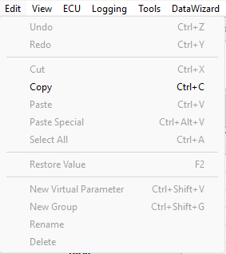

# Edit Menu

| Command | Description |
|---|---|
| **Undo** (CTRL+Z) | Undoes the last action. |
| **Redo** (CTRL+Y) | Restores previously undone actions. |
| **Cut** (CTRL+X) | Copies the selected items to the clipboard and deletes the originals. |
| **Copy** (CTRL+C) | Copies a Window, the selected Measurement Parameters or the values of an Editable Parameter to the clipboard. The content of the clipboard can be pasted into other Windows applications such as Microsoft Excel. If you use Select All in a [1 axis](../../tuning/1-axis-map-window/1-axis-map.md) or [2 axis](../../tuning/2-axis-map-window.md) Map, the clipboard also contains the values for the map breakpoints. |
| **Paste** (CTRL+V) | Copies the contents of the clipboard to the selected location. Only available when the clipboard contains information that can be transferred to the selected Window type. See below. |
| **Paste Special** (CTRL+ALT+V) | Opens the Paste Special dialog box. Only available when the clipboard contains information that can be transferred to the selected Window type. See below. |
| **Select All** (CTRL+A) | Selects all the parameters or all the values in the Window. |
| **Restore Value** (F2) | Discards any changes to the selected value or breakpoint and replaces it with the value from the current Data Version. Editable Parameters only. |
| **New Virtual Parameter** (CTRL+SHIFT+V) | Creates a [Virtual Parameter](../parameters/virtual-parameters/index.md). Only available when the Virtual Parameter folder is selected in Parameter Explorer. |
| **New Group** (CTRL+SHIFT+G) | Creates a new Group under the selected Group in Parameter Explorer. A User Group is automatically generated with the same name as the Project. You can only create new Groups under the User Group or the Virtual Parameter folder; not under Groups created by the ASAP file. |
| **Rename** | Changes the name of the selected Group in Parameter Explorer. The Group title changes to an editable text box; press ENTER or click outside the text box to accept the new name. Only available for Groups created with **New Group**. |
| **Delete** | Deletes the selected Group, with all the sub-Groups and Parameters it contains, from Parameter Explorer. Only available for Groups created with **New Group** (and for Virtual Parameters). |

With no Project open, the Edit menu contains only **Undo**, **Redo**, **Cut**, **Copy**, **Paste** and **Select All**.

## Paste

- Measurement Parameters are added to the selected Window.
- Editable Parameter values overwrite the values currently in the selected Window, starting from the currently selected location. If the data in the clipboard is larger than the available area, the values that do not fit are lost. Pasting parameter values does not affect the breakpoint values.
- If the clipboard contains a Window, a copy of the Window is placed on the current Page.

## Paste Special

When an empty Window has been created, Paste Special can be used to copy the parameter from the clipboard into the new Window. The options are:

- **Text** - Pastes the values only (the same as Paste).
- **Parameter** - If the Window can contain more than one parameter, adds the parameter to the Window. If the Window can contain only one parameter, replaces the current parameter in the Window with the one in the clipboard. If the clipboard contains a Window, the parameters in that Window are copied to the current Window.

**See also:** [ASAP](../../project-management/asap-compatibility.md); [Data Version](../../project-management/program-and-data-versions/index.md); [Menus](index.md); [Parameter Explorer](../parameters/parameter-explorer.md); [Virtual Parameter](../parameters/virtual-parameters/index.md); [Windows Context Menu](context-menus/windows-context-menu.md)
