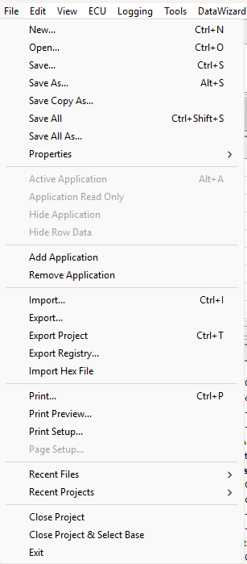

# File Menu

The File menu has more commands when a Project is open.

## With a Project open

| Command | Description |
|---|---|
| **New...** (CTRL+N) | Opens the [File Type Selection](../../project-management/files/file-type-selection.md) dialog box. Select the type of file you want to create. |
| **Open...** (CTRL+O) | Opens the File Type Selection dialog box. Select the type of file you want to open. |
| **Save...** (CTRL+S) | Saves the project, data version, desktop or logging configuration. See [Saving Files](../../project-management/files/saving-files.md) for a description of all save commands. |
| **Save As...** (ALT+S) | Saves the project, data version, desktop or logging configuration with a new name. |
| **Save Copy As...** | Saves a copy of a file under a new name. |
| **Save All** (CTRL+SHIFT+S) | Saves the project together with its data versions, desktop and logging configurations. |
| **Save All As...** | Saves the project and its files under a new name. |
| **Properties** | Sub-menu: **Project** opens the [Project Properties](../../project-management/projects/properties/project-properties.md); **Connections...** opens the [Connections](../../project-management/projects/properties/connections.md) dialog box; below these there is one entry for each Application in the Project, which opens its [Application Properties](../../project-management/projects/properties/index.md). |
| **Active Application** (ALT+A) | Makes the Application selected in Parameter Explorer the [Active Application](../../project-management/active-application.md). |
| **Application Read Only** | Makes the selected Application Read Only. |
| **Hide Application** | Hides the selected Application in the [ECU Bar](../tool-and-information-bars/ecu-bar.md). Not available during Live Updates. |
| **Hide Row Data** | Hides the row data for the selected Application. Not available during Live Updates. |
| **Add Application** | Adds an Application to the Project. Not available during Live Updates. |
| **Remove Application** | Removes an Application from the Project. Only available when the Project has more than one Application and Live Updates is off. |
| **Import...** (CTRL+I) | Opens the Import dialog box to copy Program Version, Data Version and other System Monitor files into the Multi-Application Base. See [Importing Files](../../project-management/files/importing-files.md). |
| **Export...** | Opens the Export dialog box to copy Program Version, Data Version and other System Monitor files out of the Multi-Application Base. See [Exporting Files](../../project-management/files/exporting-files.md). |
| **Export Project** (CTRL+T) | Creates an export file containing the Project file and its sub-documents. |
| **Export Registry...** | Saves the current System Monitor registry settings to a backup file (default name `reg_ddmmyy_hhmm.bak`). |
| **Import Hex File** | Imports a Hex file into the Edit Buffer. See [Importing Hex Files](../../project-management/developing-data-versions/importing-hex-files.md). |
| **Print...** (CTRL+P) | Prints the selected Window. See [Printer Support](../printing/printer-support.md). |
| **Print Preview...** | Previews the printout of the selected Window. See [Print Preview](../printing/print-preview.md). |
| **Print Setup...** | Opens the Print Setup dialog box to select a printer and printing options. |
| **Page Setup...** | Opens the Page Setup dialog box. |
| **Recent Files** | Sub-menu listing the most recently used files, excluding Project files. Select a file to open it in the current Project. |
| **Recent Projects** | Sub-menu listing the most recently used Projects. Select a Project to close the current Project and open the selected one. |
| **Close Project** | Closes the Project, with its program and data versions, desktop and logging configurations, without exiting System Monitor. |
| **Close Project & Select Base** | Closes the Project and opens the dialog box to select the Customer Base. |
| **Exit** | Closes the Project and exits System Monitor. |

!!! note
    With a GT Customer licence the Save commands are unavailable.

## With no Project open

| Command | Description |
|---|---|
| **New...** (CTRL+N) | Opens the File Type Selection dialog box. |
| **Open...** (CTRL+O) | Opens the File Type Selection dialog box. |
| **Import...** (CTRL+I) | Opens the Import dialog box. |
| **Export...** | Opens the Export dialog box. |
| **Export Registry...** | Saves the current System Monitor registry settings to a backup file. |
| *Recent projects* | The most recently used Projects. Select one to open it. |
| **Select Base...** (CTRL+S) | Opens the dialog box to select the Active [Multi-Application Base](../../project-management/customer-bases/multi-application-base.md). |
| **Exit** | Exits System Monitor. |

When the Advanced Setting **Enable Unit.Def configuration** is **Y**, **Select Base...** is replaced by **Manage Unit.Def Files...** (CTRL+S) and an **Open...** sub-menu is added, containing **Browse for Folder...** and a list of recently used Unit.Def folders. See [Unit.Def Management](../../project-management/unit-def-management/file-management.md).

**See also:** [Active Application](../../project-management/active-application.md); [Exporting Files](../../project-management/files/exporting-files.md); [Importing Files](../../project-management/files/importing-files.md); [Importing Hex Files](../../project-management/developing-data-versions/importing-hex-files.md); [Menus](index.md); [Multi-Application Base](../../project-management/customer-bases/multi-application-base.md)
