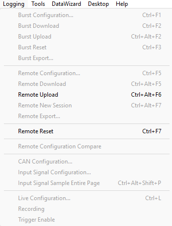

# Logging Menu

The Logging menu is available when a Project is open.

| Command | Description |
|---|---|
| **Burst Configuration...** (CTRL+F1) | Opens the [Burst Logging](../../data-acquisition/logging/burst-logging/index.md) dialog box to configure Burst Logging. |
| **Burst Download** (CTRL+F2) | Transfers the Burst Logging configuration from System Monitor to the ECU. See [Loading Configurations](../../data-acquisition/logging/loading-configurations.md). |
| **Burst Upload** (CTRL+ALT+F2) | Transfers the Burst Logging configuration from the ECU to System Monitor. |
| **Burst Reset** (CTRL+F3) | Sends a message to the ECU to clear data from its [Burst Memory](../../data-acquisition/logging/logging-memory-allocation.md). |
| **Burst Export...** | Exports the Burst Logging configuration to disk. See [Burst Logging – Export](../../data-acquisition/logging/burst-logging/burst-logging-export.md). |
| **Remote Configuration...** (CTRL+F5) | Opens the [Remote Logging](../../data-acquisition/logging/remote-logging/index.md) dialog box to edit the Remote Logging configuration. |
| **Remote Download** (CTRL+ALT+F5) | Transfers the Remote Logging configuration from System Monitor to the ECU. |
| **Remote Upload** (CTRL+ALT+F6) | Transfers the Remote Logging configuration from the ECU to System Monitor. |
| **Remote New Session** (CTRL+ALT+F7) | Creates a new Remote Logging session on the ECU. |
| **Remote Export...** | Exports the Remote Logging configuration to disk. |
| **Remote Reset** (CTRL+F7) | Sends a message to the ECU to clear data from its Remote Memory. Not available when the Advanced Setting **ECU Read Only mode** is **Y**, or when the ECU is in FIA Race mode. |
| **Remote Configuration Compare** (CTRL+F6) | Opens the [Logging Configuration Compare](../../data-acquisition/logging/remote-configuration-compare/index.md) dialog box to compare and merge logging configurations. |
| **CAN Configuration...** (CTRL+F8) | Opens the [CAN Configuration](../../data-acquisition/logging/can-configuration/can-configuration-dialog-box/index.md) dialog box to create and edit CAN messages. Only available when a unit in the Project has CAN buses. |
| **CAN Configuration Compare** (CTRL+F9) | Compares CAN configurations. Available under the same conditions as **CAN Configuration**. |
| **Input Signal Configuration...** | Opens the [Input Signal Configuration tool](../../data-acquisition/sensors/external-inputs/input-signal-configuration-tool.md). Only available if a Program Version in the Project defines input signal groups. |
| **Input Signal Sample Entire Page** (CTRL+ALT+SHIFT+P) | Makes all Signal Sampling windows on the current Page resample their parameters. Only available when the ECU is On-Line and the Page contains a Signal Sampling window. |
| **Live Configuration...** (CTRL+L) | Opens the [Live Logging](../../data-acquisition/logging/live-logging/index.md) dialog box. Not available when the ECU is On-Line. |
| **Recording** | Starts or stops recording of parameter values to disk, using the Live Logging configuration in your Project. If you do not have a Live Logging configuration you have to [create](../../data-acquisition/logging/live-logging/index.md) one. See [Live Logging – Recording](../../data-acquisition/logging/live-logging/recording.md). |
| **Trigger Enable** | Enables or disables the trigger that starts and stops recording to disk. See [Live Logging - Automatic Recording](../../data-acquisition/logging/live-logging/automatic-recording.md). |

!!! note
    **CAN Configuration** and **CAN Configuration Compare** are unavailable with a Formula E licence.

**See also:** [Data Acquisition](../../data-acquisition/index.md); [Live Logging - Automatic Recording](../../data-acquisition/logging/live-logging/automatic-recording.md); [Menus](index.md); [Remote Memory](../../data-acquisition/logging/logging-memory-allocation.md)
