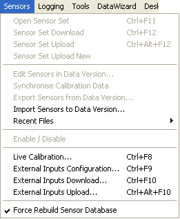

# Sensors Menu

The Sensors menu is available when a Project is open. It is not shown if an Application in the Project indicates, in its system constants, that it does not support sensor calibration.

| Command | Description |
|---|---|
| **Open Sensor Set** (CTRL+F11) | Opens the Sensors & Actuators dialog box for the Sensor set last opened in the current Project. If there is no Sensor set, this command is not available. To open a different Sensor set file, see [Opening Files](../../project-management/files/opening-files.md). |
| **Sensor Set Download** (CTRL+F12) | Sends the Sensor set to the ECU. The previous Sensor set in the ECU is overwritten. |
| **Sensor Set Upload** (CTRL+ALT+F12) | Extracts sensor data from the ECU and opens the Sensors & Actuators dialog box showing that data. The contents of the Sensor set associated with the Project are overwritten. If there is no Sensor set, a new one is created. |
| **Sensor Set Upload New** | Extracts sensor data from the ECU and opens the Sensors & Actuators dialog box showing that data. A new Sensor set is created. |
| **Edit Sensors in Data Version...** | Opens a dialog box for editing the sensors held in the Data Version. |
| **Synchronise Calibration Data** | Synchronises the Data Version with the sensor calibration database. |
| **Export Sensors from Data Version...** | Exports the sensors part of the Data Version to a file. |
| **Import Sensors to Data Version...** | Imports sensor data from a file into the Data Version. |
| **Recent Files** | Sub-menu listing recently exported sensor data versions. |
| **Enable / Disable** | Enables or disables the selected sensors. See [Enabling and Disabling Sensors and Actuators](../../data-acquisition/sensors/sensors-and-actuators/enabling-and-disabling-sensors-and-actuators.md). |
| **Live Calibration...** | Opens the [Sensor Calibration Tool](../../data-acquisition/sensors/software-calibrated-sensors/sensor-calibration-tool.md). Shortcut CTRL+SHIFT+F8. |
| **External Inputs Configuration...** | Opens the [External Inputs Configuration](../../data-acquisition/sensors/external-inputs/external-inputs-configuration.md) dialog box to configure sensor inputs. Only available if an Application supports External Inputs and an External Inputs configuration is open. Shortcut CTRL+B. |
| **External Inputs Download...** (CTRL+F10) | Transfers the External Inputs configuration from System Monitor to the ECU. See [Loading Configurations](../../data-acquisition/logging/loading-configurations.md). |
| **External Inputs Upload...** (CTRL+ALT+F10) | Transfers the External Inputs configuration from the ECU to System Monitor. See [Loading Configurations](../../data-acquisition/logging/loading-configurations.md). |
| **Force Rebuild Sensor Database** | Forces a rebuild of the sensor database, whatever the file dates, the next time the Sensors & Actuators dialog box is opened (Sbinary.exe is run). This option resets automatically. |

!!! note
    The menu labels show CTRL+F8 for **Live Calibration** and CTRL+F9 for **External Inputs Configuration**, but those keys run **CAN Configuration** and **CAN Configuration Compare** on the Logging menu. Use CTRL+SHIFT+F8 and CTRL+B instead. See [Keyboard Operation](../keyboard-operation.md).

**See also:** [Sbinary.exe](../../data-acquisition/sensors/software-calibrated-sensors/calibration-files.md); [Sensors](../../data-acquisition/sensors/index.md); [Sensors & Actuators dialog box](../../data-acquisition/sensors/sensors-and-actuators/sensors-and-actuators-dialog-box.md); [Sensor set](../../data-acquisition/sensors/sensors-and-actuators/sensor-sets.md)
