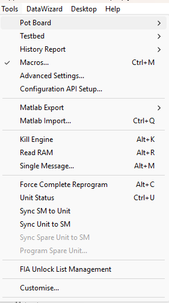

# Tools Menu

## With a Project open

| Command | Description |
|---|---|
| **Pot Board** | Sub-menu: **Configure...** (CTRL+SHIFT+F1), **Enable** (CTRL+SHIFT+F2), **Reset Adjustments** (CTRL+SHIFT+F3) and **Recent Files** (recently opened pot board configurations). See [Adjustment Board Control](../../tuning/adjustment-board-control/adjustment-board-control.md). |
| **Testbed** | Sub-menu: **Configure...** (CTRL+SHIFT+F5), **Enable Link** (CTRL+SHIFT+F6) and **Message Window** (CTRL+SHIFT+F7). See [Testbed Operation](../../testbed-operation/index.md). |
| **History Report** | Sub-menu: **Open History Report**, **Upload**, **Download**, **Reset Engine Stats** and **Reset Chassis Stats**. See [History Report](../../history-report/index.md). |
| **Macros...** (CTRL+M) | Opens the [Macros](../../developer-functions/productivity-tools/macros.md) dialog box, where you create, record and edit macros. |
| **Advanced Settings...** | Opens the Advanced Settings dialog box, where you configure System Monitor. See [Settings](../settings.md). |
| **Configuration API Setup** | Sub-menu: **Configuration API Setup...** opens the [Configuration API Setup](../../configuration-api/configuration-api-setup.md) dialog box; **Configuration API Start**, **Configuration API Stop** and **Configuration API Reset** start, stop and restart the Configuration API service. Start and Reset are only available when the Configuration API is licensed and enabled; Stop is only available when it is running. |
| **Matlab Export** | Exports Editable Parameters to a file in a format suitable for [MATLAB](../../project-management/developing-data-versions/export-to-matlab.md). The sub-menu selects what is exported: **All Parameters**, **Selected Parameters Only**, **Selected Application Parameters Only**, **Parameter Selection** or **Application Differences Only**. Each has the options **Definition and Data...** and **Data Only...**. **Export without versioning** contains the same choices. |
| **Matlab Import...** (CTRL+Q) | Browse for MATLAB format files to import into System Monitor. The Parameters in the import file are processed in order. If a Parameter definition does not match that of the current Program Version, it is discarded. If a Parameter appears more than once, the final value is that of the last appearance. |
| **Kill Engine** (ALT+K) | Sends engine kill messages to the unit, to stop the engine or prevent it from starting. See [Kill Engine](../../ecu-control/kill-engine.md). |
| **Read RAM** (ALT+R) | Opens a Read RAM window, which displays the content of memory for a controller in the attached ECU. See [Read RAM](../../ecu-control/ecu-memory/read-ram.md). |
| **Single Message...** (ALT+M) | Opens the Single Message dialog box to send a message to the ECU and view the response. See [Single Message](../../ecu-control/single-message.md). |
| **Force Complete Reprogram** (ALT+C) | Reprograms all code and data areas on the ECU, whether they have changed or not. See [Force Complete Reprogram](../../ecu-control/ecu-memory/force-complete-reprogram.md). |
| **Unit Status** (CTRL+U) | Opens the [Unit Status](../../ecu-control/unit-status.md) dialog box, where you view and synchronise the files loaded into the Edit Buffer and the unit. |
| **Sync SM to Unit** | Synchronises the program versions, data versions and configuration files in System Monitor to those on the unit. |
| **Sync Unit to SM** | Synchronises the program versions, data versions and configuration files on the unit to those in System Monitor. |
| **Sync Spare Unit to SM** | Synchronises the files on the Spare Unit to those in System Monitor. Only available when a [Spare Car](../../project-management/projects/creating-a-project/spare-car.md) is defined for the Project and the link type is IP. |
| **Program Spare Unit...** | Downloads programs, data and configurations to the Spare Unit. Available under the same conditions as **Sync Spare Unit to SM**. See [Reprogramming the ECU](../../ecu-control/ecu-memory/reprogramming-the-ecu.md). |
| **FIA Unlock List Management** | Manages FIA Parameter Unlock Lists. Only shown with an FIA team licence. |
| **Customise...** | Opens the Custom Menus dialog box, where you create additional Tools menu commands that run executable files. Custom commands appear above **Customise...** in this menu. Unavailable with a GT Customer licence. See [Custom Menus](../../developer-functions/productivity-tools/custom-menus.md). |

!!! note
    **Unit Status**, **Sync SM to Unit** and **Sync Unit to SM** are also on the [Standard Tool Bar](../tool-and-information-bars/standard-tool-bar.md).

## With no Project open

The Tools menu contains **Macros...** (CTRL+M), **Advanced Settings...**, the **Configuration API Setup** sub-menu and **Customise...**.

**See Also:** [Custom Menus](../../developer-functions/productivity-tools/custom-menus.md); [Export to MATLAB](../../project-management/developing-data-versions/export-to-matlab.md); [Force Complete Reprogram](../../ecu-control/ecu-memory/force-complete-reprogram.md); [History Report](../../history-report/index.md); [Kill Engine](../../ecu-control/kill-engine.md); [Read RAM](../../ecu-control/ecu-memory/read-ram.md); [Settings](../settings.md); [Single Message](../../ecu-control/single-message.md); [Spare Car](../../project-management/projects/creating-a-project/spare-car.md); [Unit Status](../../ecu-control/unit-status.md)
