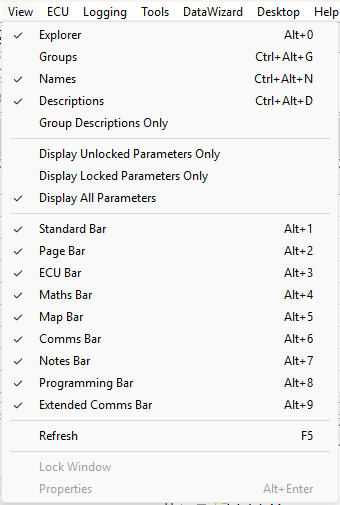

# View Menu

| Command | Description |
|---|---|
| **Explorer** (ALT+0) | Shows or hides the [Parameter Explorer](../parameters/parameter-explorer.md). |
| **Groups** (CTRL+ALT+G) | Arranges the Parameters in Parameter Explorer in Groups. |
| **Names** (CTRL+ALT+N) | Shows Parameter Names in Parameter Explorer. |
| **Descriptions** (CTRL+ALT+D) | Shows Parameter Descriptions in Parameter Explorer. |
| **Group Descriptions Only** | Shows only the descriptions of Groups in Parameter Explorer. |
| **Display Unlocked Parameters Only** | Parameter Explorer shows only unlocked parameters. See [Locked Parameters](../parameters/locked-parameters/locked-parameters.md). |
| **Display Locked Parameters Only** | Parameter Explorer shows only locked parameters. |
| **Display All Parameters** | Parameter Explorer shows all parameters. |
| **Standard Bar** (ALT+1) | Shows or hides the [Standard Tool Bar](../tool-and-information-bars/standard-tool-bar.md). |
| **Page Bar** (ALT+2) | Shows or hides the Page Bar. |
| **ECU Bar** (ALT+3) | Shows or hides the [ECU Bar](../tool-and-information-bars/ecu-bar.md). |
| **Maths Bar** (ALT+4) | Shows or hides the [Maths Bar](../tool-and-information-bars/maths-bar.md). |
| **Map Bar** (ALT+5) | Shows or hides the [Map Bar](../tool-and-information-bars/map-bar.md). |
| **Comms Bar** (ALT+6) | Shows or hides the [Comms Bar](../tool-and-information-bars/comms-bar.md). |
| **Notes Bar** (ALT+7) | Shows or hides the [Notes Bar](../tool-and-information-bars/notes-bar.md). |
| **Programming Bar** (ALT+8) | Shows or hides the Programming Bar, which logs the progress of ECU programming. |
| **Extended Comms Bar** (ALT+9) | Shows or hides the [Extended Comms Bar](../tool-and-information-bars/extended-comms-bar.md). |
| **Refresh** (F5) | Redraws the active Window. |
| **Lock Window** | Locks the size and position of the Window in focus and disables its System Menu options. |
| **Properties** (ALT+ENTER) | Opens the [Window Properties](../windows/using-windows/window-properties.md) dialog box for the selected Window. When an item is selected in Parameter Explorer, opens the Properties dialog box for that item. |

With no Project open, **Refresh**, **Lock Window** and **Properties** are not on the menu, and the Page Bar, ECU Bar and Map Bar commands are unavailable.

**See also:** [Menus](index.md); [Parameter Explorer](../parameters/parameter-explorer.md); [Main Window](../main-window.md); [Tool and Information Bars](../tool-and-information-bars/index.md)
