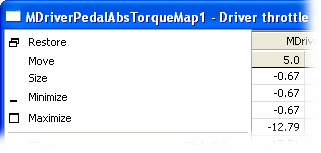
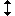

# Window System Menu

The System Menu allows you to control the appearance of a Window.

To open the System Menu, click the icon at the left of the Window title bar, or press ALT+- (ALT and the minus key). If the Title Bar is hidden, use ALT+- to open the System Menu.

The System Menu contains a list of standard commands, followed by commands specific to that type of Window.

## Standard commands

| Command | Mouse action | Keyboard |
|---|---|---|
| **Restore**  - Returns the Window to its normal size after it has been maximised or minimised. | Click the title bar of a minimised Window. | |
| **Move** - Moves the Window on the Page. | Drag the Window title bar. | Press ALT+- then M. Use the cursor keys, then press ENTER to fix the new position. |
| **Size** - Resizes the Window. | Hold the mouse pointer on the edge of the Window until it changes to  or , then drag the border. | Press ALT+- then S. Use the cursor keys, then press ENTER to fix the new size. |
| **Minimise**  - Reduces the Window to a short title at the bottom of the Page. | Double-click the title bar to Restore. | |
| **Maximise**  - Expands the Window to fill the entire Page. All other Windows are hidden. | Double-click the title bar. | |
| **Close** - Closes the Window. Unavailable when the Window is locked. | Click  | CTRL+F4 |
| **Next** - Selects the next Window on the Page. | | CTRL+F6 or CTRL+TAB. CTRL+SHIFT+F6 or CTRL+SHIFT+TAB selects the previous Window. |

## Commands on most Windows

| Command | Description |
|---|---|
| **Show Title Bar** | When ticked, the Window Title Bar is displayed. |
| **Appear on Every Page** (CTRL+E) | When ticked, the Window is shown on every Page. |
| **Lock Window** | Locks the Window size and position. A locked Window cannot be resized or closed. |
| **Window Properties...** (ALT+ENTER) | Opens the [Window Properties](../windows/using-windows/window-properties.md) dialog box for the Window. |

## Commands for specific types of Window

| Command | Description |
|---|---|
| **Engineering** | Values are displayed as text using the Format and Conversion defined in the Parameter Properties. This is the default. |
| **Raw Hexadecimal** | The raw data in the ECU are displayed as hexadecimal numbers, not converted to engineering values. |
| **Raw Binary** | The raw data in the ECU are displayed as binary numbers, not converted to engineering values. |
| **Raw Decimal** | The raw data in the ECU are displayed as decimal numbers, not converted to engineering values. |
| **Address** | The memory location of each value is shown in hexadecimal instead of the value. Not available in compare mode. |
| **Live Tune Overview** | Values are not shown and the empty cells are made as small as possible. |
| **Graphical** | See [Graphical Maps](../../tuning/graphical-maps/index.md). |
| **Difference** | See [Difference View](../../tuning/graphical-maps/difference-view.md). |
| **Reduced** | Always unavailable. |
| **End** | See [End View](../../tuning/graphical-maps/end-view.md). 2-axis Maps only. |
| **Compare Overview**, **Compare Grid**, **Show Only Where Dtv's Differ**, **Show Value**, **Show Delta Value From Memory**, **Show Delta % From Memory**, **Show Delta Value From Dtv1**, **Show Delta % From Dtv1**, **Show Delta Value From Dtv2**, **Show Delta % From Dtv2** | Display options for Map Compare windows; unavailable in other Map windows. See [Map Compare Window](../../project-management/data-wizard/map-compare-window.md). |
| **Toggle Grid / Graphical** (ALT+G) | Switches the display between a grid of text values and a graph of values. The most recently selected type of each display is used. |
| **AutoZoom** | When ticked, the vertical axis is scaled so that the traces fit the plot area. |
| **Orientation** | For a 1-axis Map, each Parameter is shown in a column instead of a row. For a 2-axis Map, the X and Y parameters are exchanged. For a Bar Graph, the bars are shown horizontally instead of vertically. Default off. |
| **Centre Active Site** | Keeps the active site in the centre of the display. 2-axis Maps only. |
| **Show Trace as Block** | Shows the trace as a block. |
| **Export 2d Map...** / **Export 3d Map...** | Exports the map to a file. |
| **Show Edit Bar** | Shows the Edit Bar. See [1-axis Map](../../tuning/1-axis-map-window/1-axis-map.md), [2-axis Map](../../tuning/2-axis-map-window.md) and [Array](../../tuning/array-window.md). |
| **Show String Bar** | Shows the String Bar. |
| **Zero All Values** (ALT+Z) | Applies an offset to every Measurement Parameter in the Window so that its displayed value is zero. |
| **Clear All Display Offsets** (ALT+D) | Removes the display offsets from the Measurement Parameters in the Window. |
| **Normal Font** | Text is displayed using the default font. |
| **Large Font** | Text is displayed using a font 4 times larger than the default font. |
| **Show Column Headings** | When ticked, the column headings are displayed at the top of the Window. |
| **Fill Window** | The bars fill the Window. Bar Graph only. |

The commands on each type of Window are:

| Window | Commands (in addition to the standard commands) |
|---|---|
| Numeric, Big Number | Engineering, Raw Hexadecimal, Raw Binary, Raw Decimal, Zero All Values, Clear All Display Offsets, Normal Font, Large Font, Show Column Headings, Show Title Bar, Appear on Every Page, Lock Window, Window Properties |
| Scalar | Engineering, Raw Hexadecimal, Raw Binary, Raw Decimal, Normal Font, Large Font, Show Column Headings, Show Title Bar, Appear on Every Page, Lock Window, Window Properties |
| 1-axis Map | Engineering, Raw Hexadecimal, Raw Decimal, Address, Live Tune Overview, Graphical, Difference, Reduced, the Compare commands, Toggle Grid / Graphical, AutoZoom, Orientation, Show Trace as Block, Export 2d Map, Show Title Bar, Show Edit Bar, Show String Bar, Appear on Every Page, Lock Window, Window Properties |
| 2-axis Map | As 1-axis Map, plus End and Centre Active Site; Export 3d Map instead of Export 2d Map |
| Array | Engineering, Raw Hexadecimal, Raw Decimal, Show Title Bar, Show Edit Bar, Show String Bar, Appear on Every Page, Lock Window, Window Properties |
| String | Appear on Every Page, Window Properties, Show Title Bar |
| Bar Graph | Engineering, Raw Hexadecimal, Raw Binary, Orientation, Fill Window, Normal Font, Large Font, Show Title Bar, Appear on Every Page, Lock Window, Window Properties |
| Oscilloscope | See [System Menu – Oscilloscope](../../data-display/oscilloscope-display/system-menu-oscilloscope.md) |
| Grid | See [System Menu – Grid](../../data-display/grid-display/system-menu-grid.md) |
| Error | Normal Font, Large Font, Show Title Bar, Appear on Every Page, Lock Window, Window Properties |
| Event | See [System Menu – Events](../../data-display/other-displays/events/system-menu-events.md) |
| Alarms | Appear on Every Page |
| Dial Gauge | Show Title Bar, Appear on Every Page, Lock Window, Window Properties |
| Signal Sampling | Sample Entire Display (CTRL+ALT+SHIFT+D), Show Title Bar, Appear on Every Page, Lock Window, Window Properties. See [Signal Sampling Display](../../data-display/signal-sampling-display.md). |
| Dashboard | Download Config, Export Config..., Import Config..., Export Current Page..., Import Page..., Copy, Paste, Undo Last Move/Resize, Appear on Every Page, Dash Properties..., Zoom Dashboard (1, 1.5 or 2). See [PCU-400 Display Unit](../../pcu-dashboard-configuration/pcu-400-display-unit.md). |
| Data Wizard windows | See [Data Wizard – Window Menu](../../project-management/data-wizard/data-wizard-window-menu.md) |

**See also:** [Menus](index.md); [Windows](../windows/index.md); [Data Wizard – Window Menu](../../project-management/data-wizard/data-wizard-window-menu.md); [System Menu – Grid](../../data-display/grid-display/system-menu-grid.md); [System Menu – Oscilloscope](../../data-display/oscilloscope-display/system-menu-oscilloscope.md); [System Menu – Event](../../data-display/other-displays/events/system-menu-events.md)
