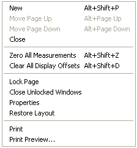

# Pages

A Desktop contains one or more Pages, each containing Windows. Typically, each Page is configured for a specific task, but there is no restriction on the number, type or size of Windows on a Page. Pages are stored as part of a Desktop and cannot be saved separately. However, you can [merge](../desktop/merging-desktops.md) Pages from one Desktop into another.

Each Page has a named tab in the **Page Bar**. To show, hide or move the Page Bar see [Tool and Information Bars](../tool-and-information-bars/index.md).

The default height of the Page Bar shows one row of tabs. If there are more tabs than fit in one row, a horizontal scroll bar is displayed. Alternatively, the Page Bar can be resized to show more rows.

To select a Page, click its tab, or:

- press PAGE DOWN for the next Page or PAGE UP for the previous Page (the selection wraps round at the ends), or
- press ALT+HOME for the first Page or ALT+END for the last Page.

Select **Desktop** > **Page** to open the Page sub-menu:

| Command | Description |
|---|---|
| **New** (ALT+SHIFT+P) | Creates a new Page after the current Page and opens the [Page Properties](page-properties.md) dialog box with the default name "New Page". |
| **Move Page Up** (ALT+PAGE UP) | Moves the selected Page up one position on the Page Bar. |
| **Move Page Down** (ALT+PAGE DOWN) | Moves the selected Page down one position on the Page Bar. |
| **Close** | After confirmation, deletes the current Page and all the Windows on it. |
| **Zero All Measurements** (ALT+SHIFT+Z) | Applies an offset to all Measurement Parameters in all Windows on the Page so that their displayed values are zero. Overrides offsets applied to individual Parameters in Parameter Properties - [Conversion tab](../parameters/parameter-properties/conversion-tab.md). Only available when the ECU is On-Line. |
| **Clear All Display Offsets On Page** (ALT+SHIFT+D) | Removes the display offsets from all Measurement Parameters on the Page, whether applied in Parameter Properties or with Zero All Measurements. |
| **Resize Views On Page To Fit Contents** (ALT+SHIFT+F) | Resizes each Window on the Page to fit its contents. |
| **Lock Page** | When ticked, locks the size and position of all Windows on the Page. Editable Parameter values can still be edited. Window System Menus are disabled while the Page is locked. Windows can also be locked individually (see [Window System Menu](../menus/window-system-menu.md)). New Windows cannot be added to a locked Page. |
| **Close Unlocked Windows** | Closes all the Windows on the Page that are not locked. |
| **Properties** | Opens the [Page Properties](page-properties.md) dialog box to edit the Page name and tab colour. |
| **Restore Layout** | Restores the layout of the Page from the last saved Desktop. |
| **Print** | Prints all the Windows on the current Page. See [Printer Support](../printing/printer-support.md). |
| **Print Preview...** | Previews the printout of all the Windows on the current Page. See [Print Preview](../printing/print-preview.md). |

!!! note
    If the Advanced Setting **Zero Offset Sampling Time (ms)** is 0, the zeroing feature is disabled and **Zero All Measurements** and **Clear All Display Offsets On Page** are removed from the menu. Restart System Monitor after re-enabling it to restore them.

**See also:** [Desktop](../desktop/index.md); [Desktop Menu](../menus/desktop-menu.md); [Merging Desktops](../desktop/merging-desktops.md); [Tool and Information Bars](../tool-and-information-bars/index.md); [Windows](../windows/index.md)
