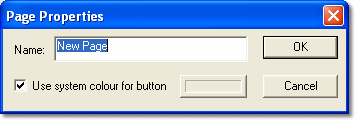

# Page Properties

The Page Properties dialog box allows you to edit the Page name shown on the Page Bar and to select the Page tab colour. To open the dialog box select **Desktop** > **Page** > **Properties**.

- **Name** - Enter or edit the Page name.
- **Use system colour for button** - When selected, the Page tab uses the system colour.

To use a custom colour for the Page tab:

1. Clear the **Use system colour for button** check box.
2. Click the colour button to open the colour selection dialog box.
3. Select a colour and click **OK**.

!!! note
    The custom colour is only used when the Page is not being viewed.

**See also:** [Pages](index.md)
