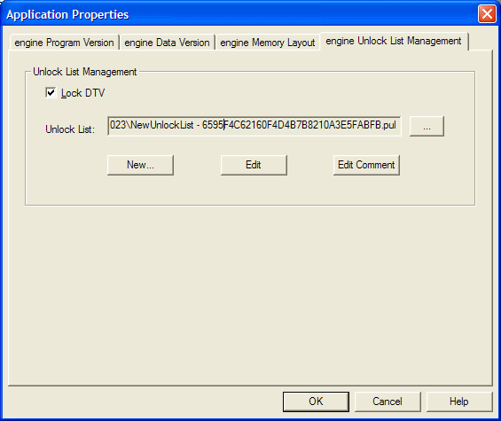
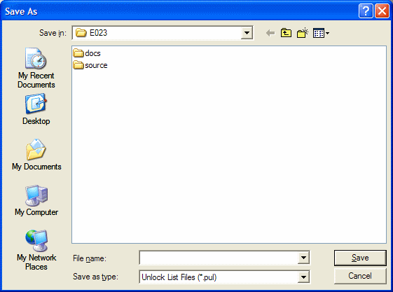
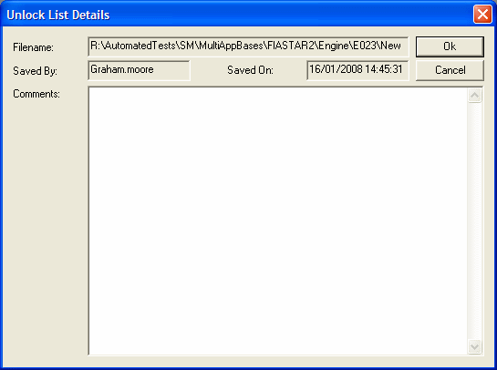

# Edit the Parameter Unlock List

The Parameter Unlock List (PUL) is edited in the Select Parameters dialog box, which you open from the Application Properties dialog box.

To edit the Parameter Unlock List:

1. In Parameter Explorer, select the Application that the PUL is associated with.
2. Right-click and select **Properties** to open the Application Properties dialog box, then select the ***Application* Unlock List Management** tab.

    

3. Select **Lock DTV** to lock the Data Version (clear it to unlock).
4. Click **...** to browse for the PUL to associate with the Application, or click **New...** to create a new PUL file (`.pul`). The path and filename of the PUL are shown in the box next to the browse button.

    

5. Click **Edit** to open the Select Parameters dialog box. The Application's measurement and editable parameters are listed on the left. Parameters that are unlocked for users with restricted access are listed on the right.
    - Click **Add** to move the selected parameters, or selected groups of parameters, to the PUL.
    - Click **Remove** to remove the selected parameters from the PUL.
    - Click **OK** to update the PUL.

    If your licence uses consortium members, the **Select PUL Members** dialog box opens first. Select the members the list applies to, or select **Unlock to ALL members**.

6. Click **Edit Comment** to open the Unlock List Details dialog box. It shows the **Filename**, **Saved By** and **Saved On** details. Enter any **Comments** and click **Ok** to save them.

    

When **Lock DTV** is selected, the **Details** list on the tab shows the **Member** (for example *All Members* or *Restricted Licence*) that each part of the PUL applies to, with its details.

**See also:** [About the Parameter Unlock List](about-the-parameter-unlock-list.md); [Locked Parameters](locked-parameters.md); [Selecting Multiple Parameters](../selecting-parameters/selecting-multiple-parameters.md)
