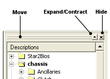

# Moving Parameter Explorer

By default Parameter Explorer is docked to the left edge of the Main Window, but it can be docked at any edge.

- Move the Parameter Explorer by dragging its top border (or its left-hand border when it is docked at the top or bottom of the Main Window).
- Double-click the top border to undock it. To dock it, drag it to any edge of the Main Window and drop it, or double-click its title bar.
- When not docked, the Parameter Explorer can be placed anywhere on the screen, even outside the Main Window. To prevent a floating Parameter Explorer from docking, hold down CTRL while dragging.
- When floating, resize the Parameter Explorer by dragging its border.
- When docked, resize it by dragging the split window separator between it and the Desktop display area.
- Click the close button to close it. To re-open it, select **View** > **Explorer** (ALT+0).

[Tool and Information Bars](../tool-and-information-bars/index.md) can also be docked, and their locations affect the positioning of the Parameter Explorer. The Expand/Contract control is available when Parameter Explorer is docked to the side of the Main Window with Tool and Information Bars above or below it. The control is a toggle: Expand increases the height of Parameter Explorer and contracts the other bars; Contract reduces the height of Parameter Explorer and expands the other bars.
