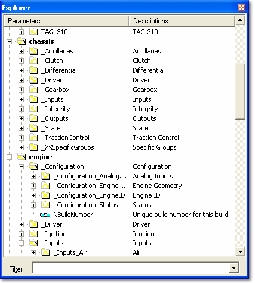
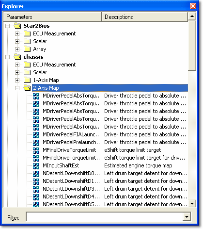

# Parameter Explorer

Parameter Explorer displays all the Parameters in the Project. It can be used to:

- create Windows
- select Parameters to paste into Windows
- open Parameter Properties
- create Groups and Virtual Parameters

Select **View** > **Explorer** (ALT+0) to show or hide the Parameter Explorer.

## Features

- Parameter Explorer can be [moved](moving-parameter-explorer.md), docked to any edge of the Main Window, and resized.
- A [Parameter Filter](selecting-parameters/parameter-filter.md) allows the Parameters displayed in the Explorer to be filtered.
- [Symbols](parameter-symbols.md) indicate the Parameter type.
- When a Parameter is highlighted in the Explorer, **View Documentation** is enabled on the context menu. This command opens documentation related to the highlighted Parameter.
- **View** menu and context menu commands arrange Parameters into [Groups](names-descriptions-and-groups.md) and show the Parameter Names, Descriptions or both. When not arranged by Groups, the Parameters are arranged by Type.
- **Display Unlocked Parameters Only**, **Display Locked Parameters Only** and **Display All Parameters** (on the **View** menu and the context menu) control whether [locked parameters](locked-parameters/locked-parameters.md) are listed.
- **Expand All** and **Collapse All** on the context menu open or close all folders. The **Default Explorer display to collapsed view** option in [Advanced Settings](../settings.md) opens the Explorer collapsed.
- The [Active Applications](../../project-management/active-application.md) are shown in bold.

A typical Parameter Explorer arranged by Groups:

A typical Parameter Explorer arranged by Parameter Type:

**See also:** [Creating Windows with Parameter Explorer](../windows/creating-windows/creating-windows-with-parameter-explorer.md)
