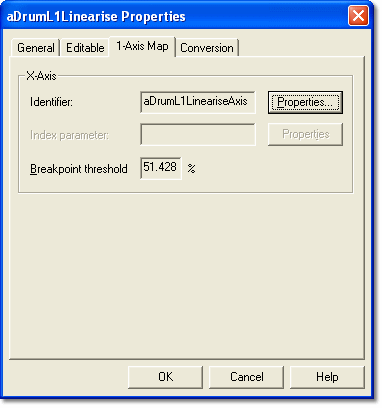

# Parameter Properties – 1-Axis Map tab

The 1-Axis Map tab of the Parameter Properties dialog box is available for 1-axis Map parameters only. The properties are defined by the ECU manufacturer in the [ASAP](../../../project-management/asap-compatibility.md) file and are read only here.

The X-axis is the only axis of a 1-axis Map. The properties in the **X-Axis** panel define the axis and how it is used.

| Control | Description |
|---|---|
| **Identifier** | The unique name of the axis definition. Click **Properties** to open the [Axis Properties](axis-properties/index.md) dialog box. |
| **Index parameter** | The Measurement Parameter used by the ECU to identify the current location on the map (the breakpoint). An Index Parameter is not required if the breakpoint is selected internally by the ECU program; the field is then unavailable. Click **Properties** to open the Parameter Properties dialog box for the Index Parameter. The Index Parameter may be used by more than one Window, so changing its properties can affect other Windows. |
| **Breakpoint threshold** | Shows the breakpoint threshold, as a percentage, used during [Live Tuning](../../../tuning/live-tune.md). Changes made in this box are not saved. |

During Live Tuning, the breakpoint closest to the actual ECU position is always highlighted. On a tabular display, the closest breakpoint is shown as a triangle, provided it is within the breakpoint threshold. As the actual ECU position moves outside the threshold, boxes are added next to the triangle to indicate the direction and distance.

The threshold can be between 0% and 50%. At 50% the triangle switches from one breakpoint to the next half-way between them, and no boxes are drawn because the actual value is always within the threshold of a breakpoint.

**See also:** [1-axis Map](../../../tuning/1-axis-map-window/1-axis-map.md); [Axis Properties](axis-properties/index.md); [Live Tune](../../../tuning/live-tune.md); [Measurement Parameters](../measurement-parameters.md)
