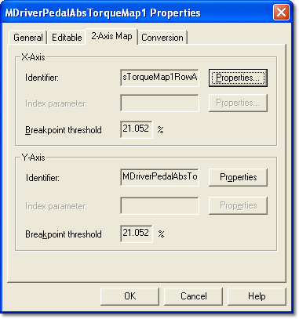

# Parameter Properties – 2-Axis Map tab

The 2-Axis Map tab of the Parameter Properties dialog box is available for 2-axis Map parameters only.

The properties are defined by the ECU manufacturer in the [ASAP](../../../project-management/asap-compatibility.md) file and are read only here.

The tab has an **X-Axis** panel and a **Y-Axis** panel. Each panel has the same controls (**Identifier**, **Index parameter** and **Breakpoint threshold**) as the [1-Axis Map](1-axis-map-tab.md) tab. As on that tab, changes made to the breakpoint thresholds are not saved.

**See also:** [2-axis Map](../../../tuning/2-axis-map-window.md); [Axis Properties](axis-properties/index.md); [Live Tune](../../../tuning/live-tune.md); [Parameter Properties – 1-Axis Map tab](1-axis-map-tab.md)
