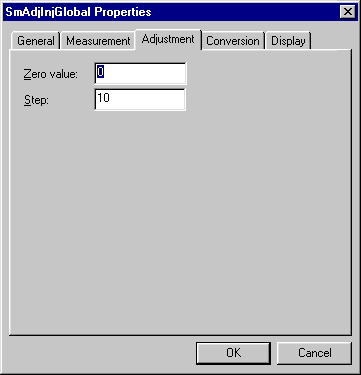

# Parameter Properties – Adjustment tab

The Adjustment tab of the Parameter Properties dialog box is available only for Measurement (ECU) or Scalar parameters that are used as Adjustment Parameters.

| Control | Description |
|---|---|
| **Zero value** | The initial value (in engineering units) of the parameter before an adjustment is made. |
| **Step** | The amount (in engineering units) by which the value of the parameter changes for each click of the adjustment control. |

**See also:** [Adjustment Board Control](../../../tuning/adjustment-board-control/adjustment-board-control.md)
