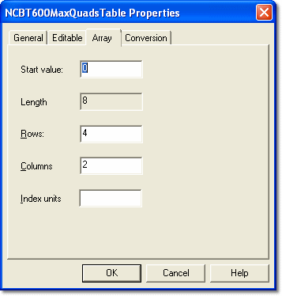

# Parameter Properties – Array tab

The Array tab of the Parameter Properties dialog box is available for Array parameters only.

| Control | Description |
|---|---|
| **Start value** | The number used to start the Array index. Default is 0. |
| **Length** | The number of values in the Array. Defined by the ECU manufacturer in the ASAP file. Read only. |
| **Rows** | The number of rows used to display the data. |
| **Columns** | The number of columns used to display the data. |
| **Index units** | Symbol or text that indicates the units used for the Array index. |

!!! note
    The values of Rows and Columns are adjusted to keep their product greater than the Length. Empty rows or columns are truncated.

**See also:** [Array](../../../tuning/array-window.md)
