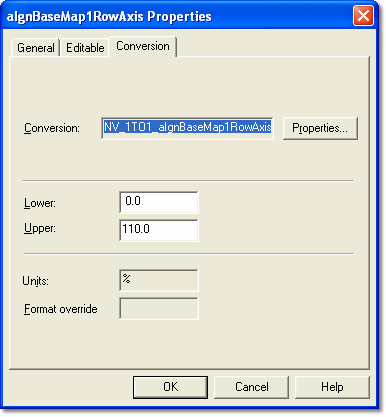

# Axis Properties – Conversion

The Conversion tab of the Axis Properties dialog box displays information about the conversion used for the axis, and allows you to edit the limits and format.

| Control | Description |
|---|---|
| **Conversion** | The conversion used for the axis. It cannot be changed here. |
| **Properties** | Opens the [Conversion Properties](../conversions/conversion-properties.md) dialog box, where you can view the read-only properties. Unavailable for a fixed axis. |
| **Lower** / **Upper** | The lower and upper limits of the breakpoint values on the axis. Read only for a fixed axis. |
| **Units** | The symbol or text that indicates the units used. This is taken from the [Conversion Properties](../conversions/conversion-properties.md). |
| **Format override** | Changes the way numbers are displayed on the axis. The syntax is described in [Number Formats](../number-formats.md). |

**See also:** [Changing Parameter Values by Keyboard](../../../../tuning/changing-parameter-values/changing-parameter-values-by-keyboard.md); [Changing Breakpoint Values by Mouse](../../../../tuning/changing-parameter-values/changing-breakpoint-values-by-mouse.md)
