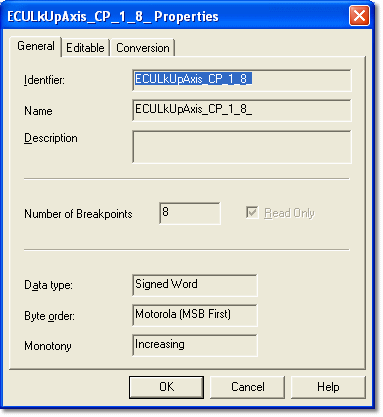

# Axis Properties – General

The General tab of the Axis Properties dialog box displays read-only information about the axis.

| Control | Description |
|---|---|
| **Identifier** | The unique name that identifies the axis. |
| **Name** | Used by System Monitor to label the axis of the displayed parameter. |
| **Description** | Additional information added by the ECU supplier. |
| **Number of Breakpoints** | The number of steps along the axis. |
| **Read Only** | When selected, the breakpoint values cannot be edited. This check box shows the setting only; it cannot be changed here. |
| **Data type** / **Byte order** | Information for developers. |
| **Monotony** | Whether the axis is ascending or descending, which indicates how the ECU stores the axis in memory: Increasing, Strict Increasing, Decreasing, Strict Decreasing or Unspecified. See [Breakpoint Monotony](../../../../tuning/changing-parameter-values/breakpoint-monotony.md). |

**See also:** [Axis Properties](index.md); [Names, Descriptions and Groups](../../names-descriptions-and-groups.md)
